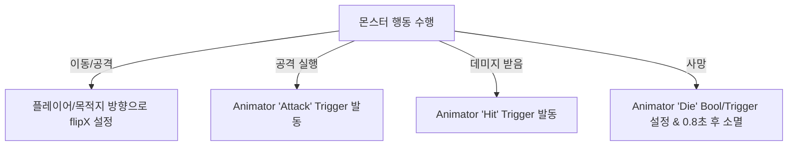
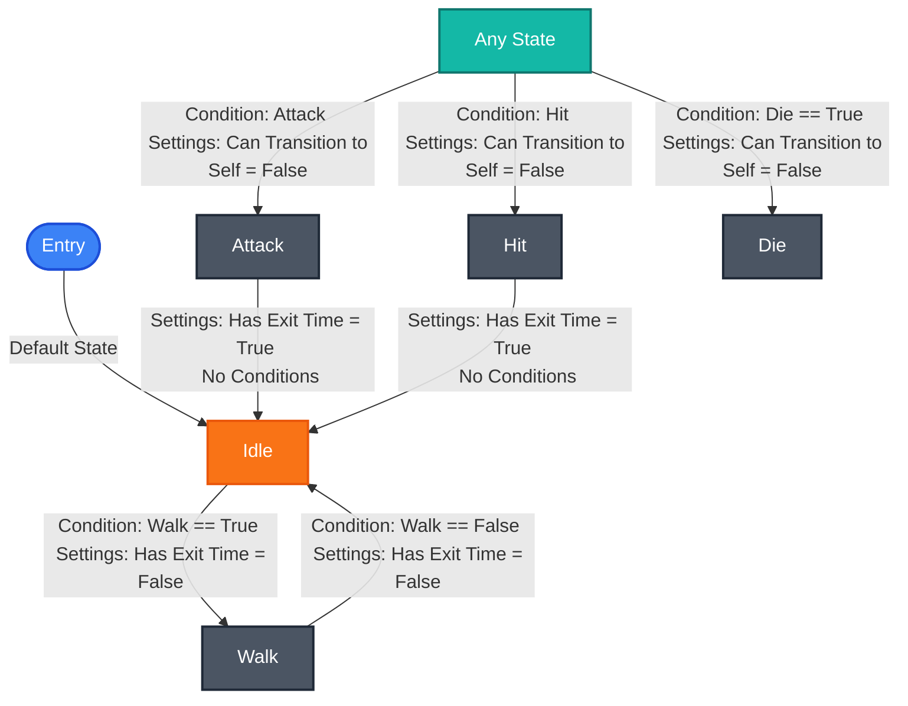

# 몬스터(Enemy) 애니메이션 및 스프라이트 방향 설정 가이드

본 문서는 유니티 에디터 상에서 몬스터 프리팹에 애니메이션을 설정하고, 코드 단의 공격/피격/사망 이벤트 및 이동 방향에 맞춘 스프라이트 방향(좌우 반전) 연동이 정상 작동하도록 구성하기 위한 가이드라인입니다.

---

## 1. 시스템 개요

격자(Grid) 시스템 기반의 턴제 전투 흐름에서 몬스터의 행동(이동, 공격 예고, 공격 실행, 피격, 사망)이 발생할 때, 시각적 일관성을 보장하기 위해 다음과 같은 흐름으로 애니메이터와 스프라이트 렌더러가 조작됩니다.



---

## 2. Animator Controller 설정 (에디터)

모든 몬스터 프리팹의 루트 또는 스프라이트 자식 오브젝트에는 **`Animator`** 컴포넌트가 부착되어 있어야 하며, 이에 연결된 **`Animator Controller`** 에 아래의 파라미터와 상태(States)가 설정되어 있어야 코드가 예외 없이 작동합니다.

### 2.1. 필수 애니메이터 파라미터 (Parameters)

에디터의 Animator 창 좌측 **Parameters** 탭에 다음 이름과 타입으로 변수를 추가하십시오. (대소문자 일치 필수)

| 파라미터 이름 | 타입 | 설명 |
| :--- | :--- | :--- |
| **`Walk`** | Bool | 몬스터가 이동을 개시할 때 `true`가 되며, 정지하면 `false`가 됩니다. |
| **`Attack`** | Trigger | 몬스터가 이전 턴에 예고했던 공격을 실제로 발동할 때 트리거됩니다. |
| **`Hit`** | Trigger | 몬스터가 플레이어에게 데미지를 입었을 때(체력이 남아있을 때) 트리거됩니다. |
| **`Die`** | Bool / Trigger | 몬스터의 체력이 0 이하가 되어 사망했을 때 트리거됩니다. |

> [!NOTE]
> 코드 내부적으로 `"Die"` 변수는 Bool 타입(`SetBool`)과 Trigger 타입(`SetTrigger`) 모두 신호를 보내도록 이중 구현되어 있으므로, 보유하고 있는 에셋의 구조에 맞춰 둘 중 하나의 타입으로 세팅하셔도 무방합니다.

### 2.2. 추천 상태 머신(State Machine) 구조 및 노드 연결

기본적인 애니메이션 트랜지션(Transitions) 구조는 다음과 같이 세팅하는 것을 권장합니다.



#### 노드 연결 상세 테이블 (Transitions & Settings)

| 출발 상태 (From) | 도착 상태 (To) | 전이 조건 (Conditions) | 필수 설정 값 (Settings) |
| :--- | :--- | :--- | :--- |
| **`Entry`** | **`Idle`** | 없음 (기본 상태 지정) | N/A |
| **`Idle`** | **`Walk`** | `Walk` == **True** | `Has Exit Time` = **False** |
| **`Walk`** | **`Idle`** | `Walk` == **False** | `Has Exit Time` = **False** |
| **`Any State`** | **`Attack`** | `Attack` (Trigger) | `Can Transition To Self` = **False** |
| **`Any State`** | **`Hit`** | `Hit` (Trigger) | `Can Transition To Self` = **False** |
| **`Any State`** | **`Die`** | `Die` (Bool == true 또는 Trigger) | `Can Transition To Self` = **False** |
| **`Attack`** | **`Idle`** | 없음 | `Has Exit Time` = **True** |
| **`Hit`** | **`Idle`** | 없음 | `Has Exit Time` = **True** |

#### 각 애니메이션 상태 설명

1. **Idle (기본 상태)**:
    * 몬스터가 가만히 대기할 때 재생되는 클립입니다. (유니티 에디터에서 기본 상태로 지정되어 주황색 노드로 표시됩니다.)
2. **Walk (이동 상태)**:
    * 몬스터가 이동 중일 때 재생되는 클립입니다. `Walk` Bool 조건이 해제되면 즉시 `Idle`로 복귀해야 하므로 `Has Exit Time`을 끕니다.
3. **Attack (공격 상태)**:
    * 공격 클립 재생이 끝나면 자동으로 기본 상태로 복귀할 수 있도록 전이선 설정에서 `Has Exit Time`을 켜고, Exit Time 수치(보통 1.0)를 맞춰둡니다.
4. **Hit (피격 상태)**:
    * 플레이어에게 맞았을 때 재생되는 모션입니다. 마찬가지로 모션 완료 후 자동으로 Idle로 돌아가도록 `Has Exit Time`을 켭니다.
5. **Die (사망 상태)**:
    * 사망 시 재생되는 모션입니다. 더 이상의 다른 행동이 불가능하므로, 복귀하는 전이선(Transition)을 절대 만들지 마십시오.
    * **중요**: 사망 애니메이션 클립 파일의 인스펙터 창에서 `Loop Time` 체크를 반드시 해제해야 몬스터가 다시 부활하는 것처럼 움직이지 않고 쓰러진 채 고정됩니다.

---

## 3. 코드 레벨의 연동 상세 (C#)

[EnemyBase.cs](file:///d:/kkh/OHP_Project/Assets/KKH/02.%20Scripts/EnemyBase.cs) 및 개별 파생 스크립트에서는 다음과 같이 제어 연동을 수행하고 있습니다.

### 3.1. 스프라이트 좌우 반전 (`flipX`)

몬스터가 플레이어의 방향이나 가고자 하는 목표 셀의 좌표에 맞춰 자동으로 좌우 스프라이트 방향을 갱신합니다.

```csharp
protected void UpdateSpriteDirection(Vector2Int targetPos)
{
    if (SpriteRenderer == null) return;

    // 타겟이 몬스터보다 왼쪽에 있으면 flipX = true (스프라이트가 우향 기본일 때)
    if (targetPos.x < GridPosition.x)
    {
        SpriteRenderer.flipX = true;
    }
    else if (targetPos.x > GridPosition.x)
    {
        SpriteRenderer.flipX = false;
    }
}
```

* **호출 시점**:
  * 일반 이동을 수행할 때 (`TryStep`)
  * 공격 범위를 장판으로 예고할 때 (`CheckAttackTelegraph`)
  * 실제 공격을 가할 때 (`ExecutePendingAttack`)
  * 고속 몬스터(박쥐, 고블린 도둑)가 시각적으로 부드럽게 이동하는 도중 (`SmoothMoveVisual`)

### 3.2. 공격 및 피격 연동

몬스터가 이전 턴에 세팅해 둔 공격 셀에 플레이어가 남아 있으면 공격 모션을 취하며 데미지를 입히고, 반대로 본인이 타격받으면 아파하는 모션을 취합니다.

```csharp
// 공격 시
if (Animator != null)
{
    Animator.SetTrigger("Attack");
}

// 피격 시 (체력이 남아있을 때)
if (Animator != null && CurrentHp > 0)
{
    Animator.SetTrigger("Hit");
}
```

### 3.3. 사망 및 지연 파괴 (`Die`)

몬스터가 죽었을 때는 사망 모션 연출이 끝까지 안전하게 재생될 시간이 필요하므로 즉시 파괴하지 않고 예약을 걸어 둡니다.

```csharp
protected virtual void Die()
{
    ClearTelegraphs();
    TurnManager.Instance.Unregister(this); // 턴 연동에서 즉시 제외 (논리적 사망)

    TimeSystem.Instance.AddTime(data.timeBonus);

    if (Animator != null)
    {
        Animator.SetBool("Die", true);
        Animator.SetTrigger("Die");

        // 시체가 물리적으로 플레이어 이동 등을 막지 않도록 Collider 즉시 끔
        var col = GetComponent<Collider2D>();
        if (col != null) col.enabled = false;

        Destroy(gameObject, 0.8f); // 0.8초간 사망 애니메이션을 보여준 뒤 오브젝트 제거
    }
    else
    {
        Destroy(gameObject); // 애니메이터가 없을 경우 즉각 파괴
    }
}
```

### 3.4. 이동 애니메이션 연동 (`Walk`)

몬스터가 이동을 시작할 때 `Walk` 파라미터를 `true`로 켜고, 이동이 끝났을 때 `false`로 꺼서 자연스럽게 걷고 정지하도록 제어합니다.

* **일반 몬스터 (격자 즉시 이동)**:
  * 이동이 일어났을 때 즉시 `Walk`가 켜진 후, 걷는 연출 시간을 확보하기 위해 턴 완료 단계에서 지연 코루틴(`ResetWalkAfterDelay`)이 돌며 `0.18초` 뒤에 자동으로 `Walk`가 꺼집니다.
* **고속/보간 몬스터 (박쥐, 고블린 도둑 등)**:
  * 자체적인 부드러운 이동 코루틴(`SmoothMoveVisual`)이 구동되는 동안에만 `Walk = true`가 유지되고, 도착 시 `false`로 꺼지도록 개별 제어됩니다.

```csharp
// 이동 성공 시 (TryStep)
if (Animator != null) Animator.SetBool("Walk", true);

// 공격 시전 또는 대기 시
if (Animator != null) Animator.SetBool("Walk", false);
```

---

## 4. 몬스터 프리팹 적용 체크리스트

새로운 몬스터를 추가하거나 기존 몬스터 에셋을 설정할 때 아래 항목을 최종 확인하십시오.

* [ ] 몬스터 프리팹 최상위 또는 자식 스프라이트 오브젝트에 `Animator` 컴포넌트가 부착되어 있는가?
* [ ] 해당 `Animator`의 Controller에 `"Attack"`, `"Hit"`, `"Die"` 파라미터가 정확하게 생성되어 있는가?
* [ ] 각 애니메이션 클립(Attack, Hit, Die)으로 이동하는 Transition의 Condition에 해당 파라미터들이 알맞게 지정되어 있는가?
* [ ] 몬스터 스프라이트 리소스의 기본 시선 방향이 오른쪽을 바라보고 있는가? (만약 기본 스프라이트가 왼쪽을 바라보고 있다면, 코드의 `UpdateSpriteDirection` 내부 `flipX` 조건을 반대로 커스텀해야 합니다.)
* [ ] 사망 모션 클립의 인스펙터 창에서 `Loop Time`이 꺼져(Uncheck) 있는가?
