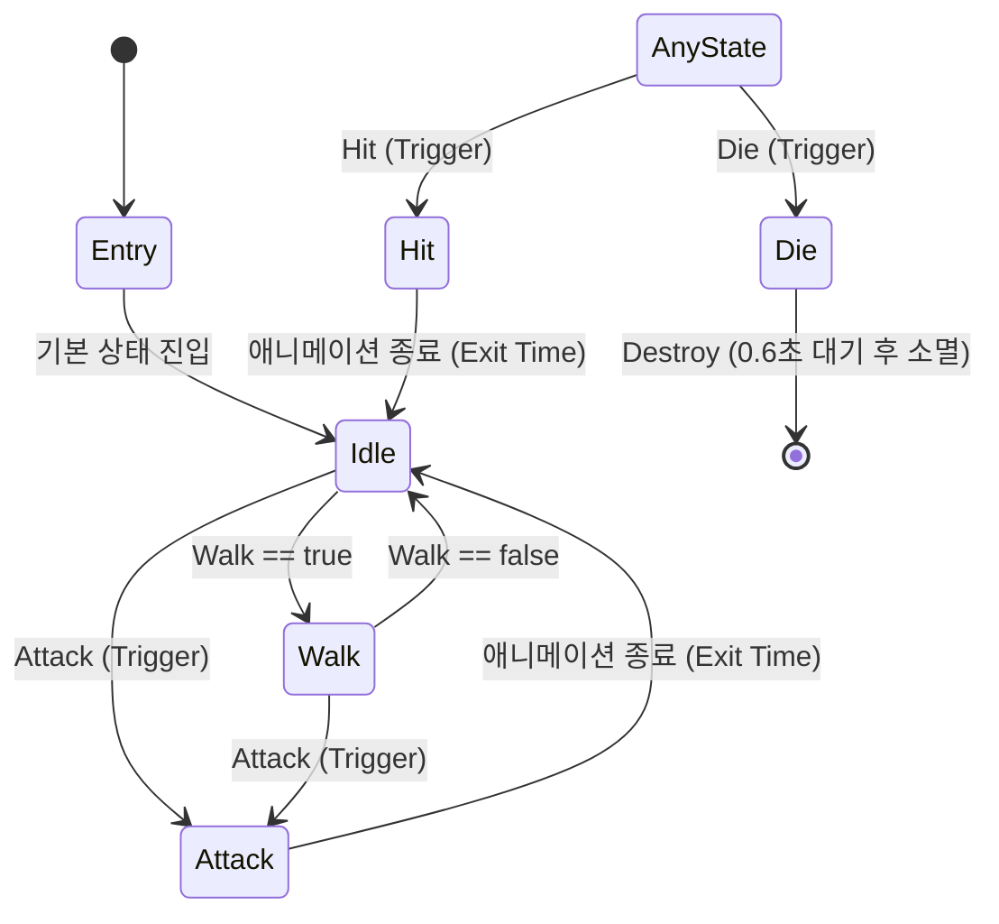

# 🎮 적(Enemy) 애니메이터 노드 연결 및 전이 설정 가이드

본 문서는 **60초 던전** 프로젝트의 각 몬스터 스프라이트 캐릭터가 플레이어의 행동과 턴 진행에 맞춰 피격, 이동, 공격, 사망 등의 애니메이션을 올바르게 재생할 수 있도록 유니티 **애니메이터 컨트롤러(Animator Controller)**의 상태(State) 구성 및 노드 연결(Transition) 표준 세팅 값을 다룹니다.

---

## 1. 필수 애니메이터 파라미터 (Parameters) 세팅

새로운 몬스터 애니메이터 컨트롤러를 생성하면, 가장 먼저 **Animator 창의 Parameters 탭**에서 아래 4가지 파라미터를 정확한 대소문자와 타입으로 추가해야 합니다.

| 파라미터명 | 타입 | 역할 | 스크립트 트리거 시점 |
| :--- | :--- | :--- | :--- |
| **`Walk`** | `Bool` | 이동(걷기) 애니메이션 재생 여부 | `PerformMovement` 이동 시 `true`, 이동 종료 후 `false` |
| **`Attack`** | `Trigger` | 공격 애니메이션 1회 재생 | `ExecutePendingAttack` 공격 타일에 플레이어 피격 시점 |
| **`Hit`** | `Trigger` | 피격 애니메이션 1회 재생 | 데미지를 입었을 때 (`HP > 0`인 생존 상태) |
| **`Die`** | `Trigger` | 사망 애니메이션 1회 재생 | 데미지를 입어 `HP <= 0`이 되어 사망할 때 |

> [!IMPORTANT]
> - 스크립트(`EnemyBase`) 내부에서 해당 파라미터 문자열을 참조하여 상태를 제어하므로, **대소문자가 틀리지 않도록** 주의해야 합니다.
> - 만약 특정 몬스터의 사망 트리거명을 다른 이름(예: `Dead`, `Death`)으로 사용하고 싶다면, 프리팹의 개별 몬스터 컴포넌트 인스펙터에 있는 **`Death Trigger Name`** 필드 값을 해당 트리거명과 일치시켜 주어야 정상 작동합니다. (기본값은 `Die`입니다.)

---

## 2. 애니메이터 상태 머신 구조 및 연결 (Mermaid)

적 캐릭터의 기본 상태 변화 흐름 및 노드 전이 구조는 다음과 같습니다.

---

## 3. 트랜지션 (Transition) 상세 설정 값

2D 픽셀 아트 기반 스프라이트 애니메이션의 특성상 프레임 보간이 불필요하므로, **모든 Transition의 설정값을 2D 전용으로 변경**해야 부드럽고 기민하게 연출됩니다.

### 3.1 걷기 <-> 대기 전이 설정 (`Idle` <-> `Walk`)
- **`Idle` -> `Walk`**:
  - **Has Exit Time**: `Uncheck` (대기 중 이동 입력이 오면 딜레이 없이 바로 걷기 시작해야 함)
  - **Transition Duration**: `0` (보간 시간 없음)
  - **Conditions**: `Walk` == `true`
- **`Walk` -> `Idle`**:
  - **Has Exit Time**: `Uncheck` (이동이 끝나면 즉시 대기 상태로 전환)
  - **Transition Duration**: `0`
  - **Conditions**: `Walk` == `false`

### 3.2 공격 전이 설정 (`Idle` / `Walk` -> `Attack` -> `Idle`)
- **`Idle` or `Walk` -> `Attack`**:
  - **Has Exit Time**: `Uncheck` (공격 턴에 예고 공격이 발동되면 즉시 공격 모션이 나가야 함)
  - **Transition Duration**: `0`
  - **Conditions**: `Attack` (Trigger)
- **`Attack` -> `Idle`**:
  - **Has Exit Time**: `Check` (공격 애니메이션이 도중에 끊기지 않고 끝까지 완료된 뒤 Idle로 복귀해야 함)
  - **Exit Time**: `1` (100% 재생 완료 의미)
  - **Transition Duration**: `0`
  - **Conditions**: 없음 (조건 없이 완료 시 대기 상태 복귀)

### 3.3 피격 전이 설정 (`Any State` -> `Hit` -> `Idle`)
- **`Any State` -> `Hit`**:
  - **Has Exit Time**: `Uncheck` (어떤 행동 중이든 타격을 입으면 즉시 피격 리액션이 재생되어야 함)
  - **Transition Duration**: `0`
  - **Conditions**: `Hit` (Trigger)
  - **Settings -> Can Transition To Self**: **`Uncheck`** (매우 중요! 다단 히트나 빠른 연속 피격 시 자기 자신으로 무한 피격 루프가 걸려 애니메이션이 멈추는 에러 방지)
- **`Hit` -> `Idle`**:
  - **Has Exit Time**: `Check` (피격 리액션이 1회 완벽히 표현된 후 대기로 이동)
  - **Exit Time**: `1`
  - **Transition Duration**: `0`
  - **Conditions**: 없음

### 3.4 사망 전이 설정 (`Any State` -> `Die`)
- **`Any State` -> `Die`**:
  - **Has Exit Time**: `Uncheck` (사망 시 모든 모션을 강제 차단하고 사망 모션 진입)
  - **Transition Duration**: `0`
  - **Conditions**: `Die` (Trigger)
- **`Die` 상태 세부 옵션**:
  - **`Loop Time`**: `Uncheck` (사망 스프라이트가 루프되어 재생되지 않고 마지막 사망 시점에 멈춰야 함)

---

## 4. 유니티 에디터 작업 체크리스트 (Summary)

1. [ ] **Parameters 탭 설정**:
   * `Walk` (Bool) 생성
   * `Attack` (Trigger) 생성
   * `Hit` (Trigger) 생성
   * `Die` (Trigger) 생성
2. [ ] **Has Exit Time 검증**:
   * `Idle` ↔ `Walk`, `Any State` → `Hit`/`Die`, `Idle`/`Walk` → `Attack` 전이 노드에서 **`Has Exit Time`이 해제**되어 있는지 확인
   * `Attack` → `Idle`, `Hit` → `Idle` 전이 노드에서 **`Has Exit Time`이 체크**되어 있는지 확인
3. [ ] **Transition Duration 검증**:
   * 2D 딜레이 해소를 위해 연결된 **모든 전이선의 `Transition Duration` 값을 `0`**으로 수정했는지 확인
4. [ ] **Can Transition To Self 검증**:
   * `Any State` → `Hit` 전이의 설정 창에서 **`Can Transition To Self`가 꺼져** 있는지 확인

---

## 5. 자가 진단 및 문제 해결 (FAQ)

### Q. 적이 피격을 당했는데 피격 모션이 0.1초 만에 뚝 끊기고 다시 대기 모션으로 돌아갑니다.
- **원인**: `Hit` 상태 노드에서 `Idle`로 돌아가는 전이선(Transition)에 **`Has Exit Time`**이 해제되어 있거나, **`Exit Time`** 값이 1보다 작게 세팅되었기 때문입니다.
- **해결**: `Hit` -> `Idle` 전이선을 클릭하고 인스펙터 창에서 `Has Exit Time`을 체크하고 `Exit Time` 값을 `1`로 채워주세요.

### Q. 적이 사망했는데 완전히 사라지지 않고 사망 모션이 계속 반복(무한 루프) 재생됩니다.
- **원인**: 해당 몬스터의 `Die` 애니메이션 클립 자체의 **`Loop Time`** 옵션이 켜져 있거나, 스크립트의 `Death Destroy Delay` 시간이 너무 짧아 애니메이션 도중 소멸되기 때문입니다.
- **해결**: `Die` 애니메이션 클립 에셋을 클릭하고 인스펙터에서 `Loop Time` 체크를 해제하세요. 또한 프리팹 컴포넌트의 `Death Destroy Delay` 수치를 애니메이션 길이와 비슷한 `0.6`초 이상으로 보정해야 합니다.
