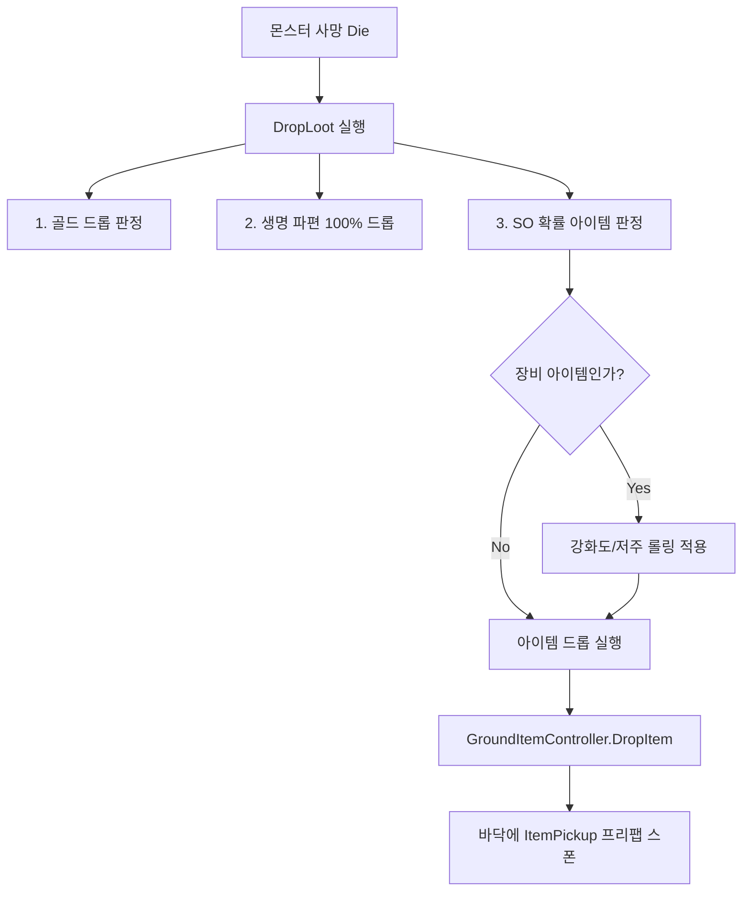

# 몬스터 전리품(Loot) 및 아이템 드롭 시스템 가이드

이 문서는 60초 던전 프로젝트의 몬스터 사망 시 보상(골드, 생명 파편, 확률 드롭 아이템)의 처리 원리와 작동 방식에 대해 상세히 설명합니다.

---

## 1. 드롭 시스템 핵심 아키텍처

몬스터 사망 시 아이템이 생성되는 과정은 **데이터 정의(SO) ➔ 무작위 판정 ➔ 장비 스펙 결정(강화/저주) ➔ 월드 인스턴스화(바닥 픽업)** 단계를 거칩니다.

---

## 2. 세부 작동 방식

### ① 골드 드롭 판정
* **데이터 필드**: `EnemyData` 내 `goldDropChance`, `goldMin`, `goldMax`
* **작동**: `UnityEngine.Random`으로 드롭 여부를 판정한 뒤 범위 안의 무작위 골드를 계산합니다. `EnemyBase.SpawnGoldDrop()`을 통해 `Gold_Pickup` 프리팹을 월드에 스폰합니다.

### ② 생명 파편(FragmentsOfLife) 100% 드롭
* **데이터 필드**: `EnemyBase` 내 `fragmentsOfLifeItem`
* **작동**: 몬스터의 등급과 상관없이 처치 시 무조건 생명 파편을 1개 드롭합니다.
* **유틸리티**: `EnemyPrefabUtility` 에디터 툴(`Tools ➔ 60s Dungeon ➔ Enemy Prefab Utility`)을 사용해 씬에 있는 모든 몬스터 프리팹의 `fragmentsOfLifeItem` 필드에 생명 파편 에셋을 일괄 연결할 수 있습니다.

### ③ 일반/장비 아이템 확률 드롭
* **데이터 필드**: `EnemyData` 내 `ItemDrop[] itemDrops` (`ItemBase item`, `chance`, `count`)
* **작동**: 각 아이템 엔트리마다 정의된 확률(`chance`) 롤을 굴려 성공 시 해당 개수(`count`)만큼 `SpawnItemDrop()`을 호출합니다.

---

## 3. 장비(Equipment) 아이템 드롭 시의 특수 처리

드롭하는 아이템이 장비(무기, 갑옷, 반지 등)인 경우 스탯 인스턴스화를 위해 고도화된 롤링 시스템이 작동합니다.

1. **강화도(Enhance Level) 추첨**:
   * GDD 9.7 등장 강화도 확률 규칙을 따릅니다.
     * **0강**: 55% / **1강**: 30% / **2강**: 10% / **3강**: 5%
   * `ItemRoll.Enhance(rng)`를 사용해 강화도를 결정합니다.
2. **저주(Curse) 여부 및 매칭 추첨**:
   * 50% 확률로 저주가 부여됩니다.
   * `ItemDatabase.Instance.Curses` 전체 데이터베이스를 조회하여, 해당 장비의 장착 슬롯(`TargetSlot`)과 **정확하게 일치하는 저주들만 필터링한 후 무작위 추첨**하여 안전하게 주입합니다. (예: 무기 드롭 시 둔화/출혈 등 방어구 저주 배제)
3. **감정 상태**:
   * 드롭되는 장비는 기본적으로 미감정(`isAnalyzed = false`) 상태로 생성됩니다.
4. **결정론적 난수(`DungeonRandom`) 연동**:
   * 맵 생성 시 지정된 층별 시드(`MapGenerator.Instance.Rng`)를 난수 발생기로 전달받아 작동하므로, 결정론적 시드 규칙을 위배하지 않습니다.

---

## 4. 월드 스폰 및 줍기 연동 (`GroundItemController`)

1. 생성된 `ItemInstance`는 `PrototypeRT.GroundItemController.Instance.DropItem(itemInst, 1, GridPosition)`을 통해 최종 월드에 배치됩니다.
2. `GroundItemController`는 바닥에 떨어진 아이템의 실제 데이터(강화도, 저주 등)가 보존될 수 있도록 `ItemPickup` 컴포넌트 내부의 `item` 인스턴스에 직접 정보를 주입합니다.
3. 플레이어가 해당 그리드 타일로 이동하거나 상호작용 키(Pickup)를 입력하면 `GroundItemController`가 인벤토리 적재 용량 및 스택 유효성을 검사한 뒤 안전하게 플레이어 인벤토리로 흡수시킵니다.
