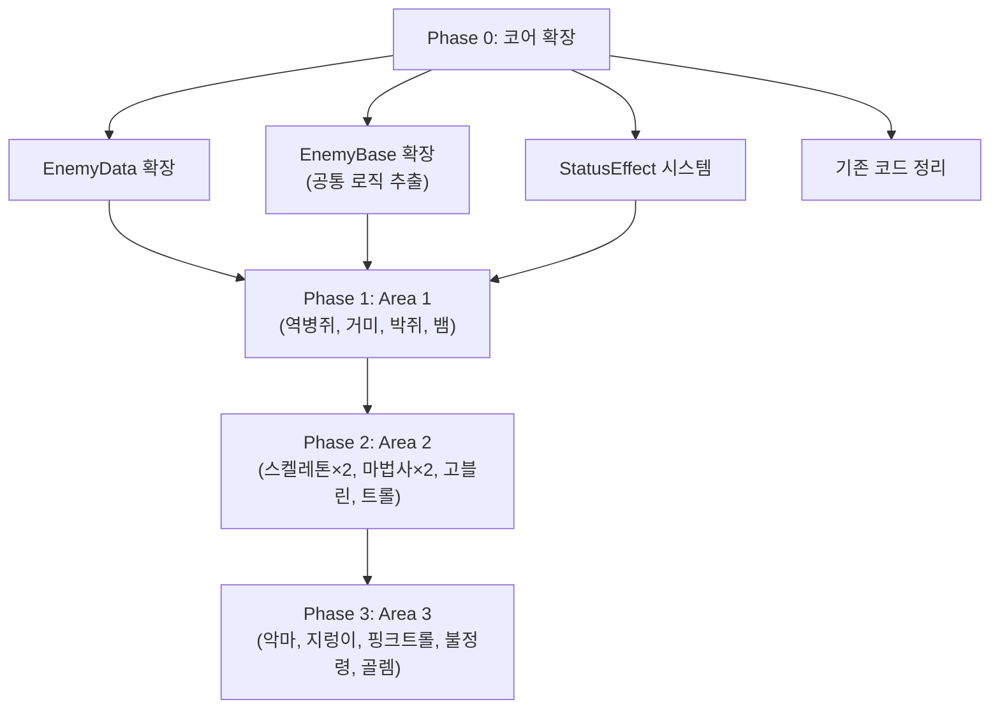

# 적(Enemy) 시스템 리팩토링 — TODO

> [!NOTE]
> GDD v1.0 기획 변경에 따른 작업 목록입니다.
> 가이드 문서: [enemy_refactor_guide.md](file:///C:/Users/Administrator/.gemini/antigravity/brain/df345fba-b45a-4490-a7de-9cac267577f6/artifacts/enemy_refactor_guide.md)

---

## Phase 0 — 코어 시스템 확장 (선행 필수)

> [!IMPORTANT]
> 이 단계를 완료해야 Phase 1~3의 개별 몬스터 구현이 가능합니다.

### EnemyData 확장
- [ ] `attackDamage` → `attackMin` / `attackMax` (범위 데미지) 로 변경
- [ ] `moveSpeed` (float, 초/칸) 필드 추가
- [ ] `attackSpeed` (float, 회/s) 필드 추가
- [ ] `defenseMin` / `defenseMax` (내구성 범위) 필드 추가
- [ ] `evasion` (회피) 필드 추가
- [ ] `accuracy` (정확도) 필드 추가
- [ ] `expReward` (경험치) 필드 추가
- [ ] `goldMin` / `goldMax` (골드 드롭 범위) 필드 추가
- [ ] `grade` (EnemyGrade enum: Common, Elite, MiniBoss, Boss) 필드 추가
- [ ] `moveType` (EnemyMoveType enum: Normal, WallPass, Stationary) 필드 추가
- [ ] `displayName` (표시명) 필드 추가
- [ ] `onHitEffect` (StatusEffectData 참조) 필드 추가 — 명중 시 상태이상
- [ ] 기존 SO 인스턴스들 마이그레이션 (기존 `attackDamage` 값을 `attackMin`/`attackMax`로 분배)

### EnemyBase 확장
- [ ] **공통 이동 로직 추출**: `TryStepTowardPlayer()` + `TryStep()` 을 EnemyBase로 이동
  - 현재 Tracker/KingsGuard/Phantom/Wraith/Crawler에 복붙된 동일 코드
  - `TryStep()`은 `virtual`로 → 벽 통과 적이 override 가능
- [ ] **템플릿 메서드 도입**: `OnTurnUpdate()`를 3단계로 분리
  - `ExecutePendingAttack()` — 이전 턴 공격 발동
  - `PerformMovement()` — 이동 처리
  - `CheckAttackTelegraph()` — 공격 예고
- [ ] `RollAttackDamage()` 메서드 추가 (min~max 랜덤)
- [ ] `ApplyDefense(int rawDamage)` 메서드 추가
- [ ] `RollHit(int targetEvasion)` 메서드 추가 (회피/정확도 판정)
- [ ] `Die()` 확장: 경험치, 골드 드롭 이벤트 발행
- [ ] `GetMoveCost()` / `GetAttackCost()` → TimeSystem 연동
- [ ] `_pendingAttackCell` 을 EnemyBase로 올리기 (대부분의 적이 사용)

### StatusEffect 시스템 (신규)
- [ ] `StatusEffectData` ScriptableObject 정의 (타입, 지속시간, 틱 데미지, 이동속도 감소 등)
- [ ] `StatusEffectType` enum (Poison, Burn, Stun, Slow, Bleed)
- [ ] `StatusEffectInstance` 클래스 (틱 관리, 지속시간 카운트)
- [ ] `IStatusEffectable` 인터페이스 — 플레이어와 적 모두 적용 가능
- [ ] EnemyBase에 상태이상 적용 훅 연결

### GameEvents 확장
- [ ] `OnEnemyKilled` 이벤트에 경험치 파라미터 추가
- [ ] `OnGoldDropped` 이벤트 추가
- [ ] `OnStatusEffectApplied` 이벤트 추가

### 기존 코드 정리
- [ ] KDU의 `GridEnemyBase.cs` — 사용처 확인 후 삭제 일정 결정
- [ ] KKH의 기존 4파일(KingsGuard/Wraith/Phantom/Crawler) → `Deprecated` 폴더로 이동
- [ ] KDU의 Tracker/Archer → 로직 추출 완료 후 `Deprecated` 폴더로 이동

---

## Phase 1 — Area 1 몬스터 (하수구, 1~5층)

### 역병 쥐 [Common]
- [ ] `EnemyPlagueRat.cs` 생성
- [ ] 이동: 기본 추적 (`TryStepTowardPlayer()` 그대로 사용)
- [ ] 공격: 근접 1칸, 텔레그래프
- [ ] 특수: 명중 시 독 (5초간 1초당 1 데미지) — `onHitEffect` SO 연결
- [ ] EnemyData SO 인스턴스 생성 (HP:8, ATK:2~4, 이동:1.0, 회피:5, 정확도:10, EXP:5, 시간:+3)
- [ ] 난이도: ★☆☆ (Tracker 거의 그대로)

### 거미 [Common]
- [ ] `EnemySpider.cs` 생성
- [ ] 이동: 기본 추적
- [ ] 공격: 근접 1칸, 텔레그래프
- [ ] 특수: 명중 시 독(5초) + 이동속도 -0.3 디버프(2초)
- [ ] EnemyData SO 인스턴스 생성 (HP:6, ATK:2~3, 이동:1.0, 회피:8, 정확도:12, EXP:5, 시간:+3)
- [ ] 난이도: ★★☆ (StatusEffect 중첩 필요)

### 박쥐 [Common]
- [ ] `EnemyBat.cs` 생성
- [ ] 이동: **고속** (moveSpeed=0.5) — **Crawler의 고속 이동 로직 재활용**
- [ ] 공격: 근접 1칸, 텔레그래프
- [ ] 특수: 없음 (높은 회피로 잡기 어려움 → 보너스 +5초)
- [ ] EnemyData SO 인스턴스 생성 (HP:5, ATK:3~5, 이동:0.5, 회피:12, 정확도:10, EXP:5, 시간:+5)
- [ ] 난이도: ★★☆ (고속 이동 시각 연출 필요)

### 뱀 [Elite]
- [ ] `EnemySnake.cs` 생성
- [ ] 이동: 기본 추적
- [ ] 공격: 독니 물기 (1.5초 공격 비용)
- [ ] 특수: 명중 시 독 (3초간 2~4 데미지)
- [ ] EnemyData SO 인스턴스 생성 (HP:20, ATK:5~8, 이동:1.0, 방어:0~1, 회피:10, 정확도:15, EXP:12, 시간:+3)
- [ ] 난이도: ★★☆

---

## Phase 2 — Area 2 몬스터 (던전, 6~10층)

### 스켈레톤 (방패 X/O) [Common]
- [ ] `EnemySkeleton.cs` 생성 — **방패 유무는 EnemyData의 플래그로 구분** (코드 1개로 2종 처리)
- [ ] 이동: 기본 추적, moveSpeed=0.75
- [ ] 공격: 근접 1칸
- [ ] 특수(방패O): 50% 확률로 방패 들기 → 다음 피격 0~2 추가 감소
  - **KingsGuard의 피해 감소 로직 참고**
- [ ] EnemyData SO 인스턴스 2개 생성 (방패X: HP:18, 방패O: HP:22, 방어:1~4)
- [ ] 난이도: ★★☆

### 마법사 스켈레톤 (방패 X/O) [Common]
- [ ] `EnemyMageSkeleton.cs` 생성 — 방패 유무는 EnemyData 플래그
- [ ] 이동: 기본 추적, moveSpeed=0.75
- [ ] 공격: **원거리 마법 (4방향 직선 LOS)** — **Archer의 `ComputeLineToPlayer()` 재활용**
- [ ] 특수(방패O): 50% 확률 방패
- [ ] EnemyData SO 인스턴스 2개 생성
- [ ] 난이도: ★★☆ (Archer 로직 거의 그대로)

### 칼 든 고블린 [Common]
- [ ] `EnemyGoblinThief.cs` 생성
- [ ] 이동: **고속** (moveSpeed=0.4) — **Crawler 고속 이동 재활용**
- [ ] 공격: 근접 1칸
- [ ] 특수: 명중 시 인벤토리 아이템 1개 랜덤 훔침 → **도주 AI** (플레이어 반대 방향 이동)
  - ⚠️ 인벤토리 시스템 의존 — 시스템 미구현 시 훔치기 없이 우선 구현
- [ ] EnemyData SO 인스턴스 생성 (HP:14, ATK:5~9, 이동:0.4, 회피:13, 정확도:15, EXP:5, 시간:+3)
- [ ] 난이도: ★★★ (도주 AI + 인벤토리 연동)

### 트롤 [Elite]
- [ ] `EnemyTroll.cs` 생성
- [ ] 이동: 기본 추적, moveSpeed=0.75
- [ ] 공격: 강타 (1.5초 비용, 인접 1×1)
- [ ] 특수: 강타 명중 시 1초 기절 (Stun) — StatusEffect 사용
- [ ] EnemyData SO 인스턴스 생성 (HP:45, ATK:12~18, 방어:2~4, 회피:8, 정확도:16, EXP:12, 시간:+5)
- [ ] 난이도: ★★☆

---

## Phase 3 — Area 3 몬스터 (용암지대, 11~15층)

### 작은 악마 [Common]
- [ ] `EnemyImp.cs` 생성
- [ ] 이동: **초고속** (moveSpeed=0.3) — **Crawler 고속 이동 재활용**
- [ ] 공격: **장판 공격** (1.5초 비용, 3×3 화염 장판 텔레그래프)
  - 텔레그래프를 3×3 범위로 확장 표시, 다음 턴 발동
  - 잔존 1초간 바닥 화염
- [ ] EnemyData SO 인스턴스 생성 (HP:16, ATK:8~14, 이동:0.3, 방어:1~2, 회피:15, 정확도:16, EXP:5, 시간:+3)
- [ ] 난이도: ★★★ (범위 텔레그래프 + 장판 잔존)

### 지렁이 [Common]
- [ ] `EnemyWorm.cs` 생성
- [ ] 이동: 기본 추적, moveSpeed=0.5
- [ ] 공격: 근접 1칸
- [ ] 특수: **이동 중 원거리 공격 면역** (투척/마법 무효) — `isRangedImmune` 플래그
  - **Wraith의 TryPhaseStep** 개념 참고 (다른 용도이지만 "특수 이동" 패턴)
- [ ] EnemyData SO 인스턴스 생성 (HP:30, ATK:10~15, 이동:0.5, 방어:2~3, 회피:5, 정확도:15, EXP:5, 시간:+3)
- [ ] 난이도: ★★☆

### 핑크 트롤 [Common]
- [ ] `EnemyPinkTroll.cs` 생성
- [ ] 이동: 기본 추적, moveSpeed=0.5
- [ ] 공격: 근접 1칸
- [ ] 특수: 없음 (순수 높은 HP 탱커)
- [ ] EnemyData SO 인스턴스 생성 (HP:60, ATK:12~18, 이동:0.5, 방어:3~5, 회피:5, 정확도:15, EXP:5, 시간:+3)
- [ ] 난이도: ★☆☆ (Tracker와 거의 동일, 스탯만 다름)

### 불의 정령 [Elite]
- [ ] `EnemyFireElemental.cs` 생성
- [ ] 이동: 기본 추적, moveSpeed=0.5
- [ ] 공격: 근접 1칸
- [ ] 특수: 명중 시 화상 (3초간 1초당 2 데미지) — `onHitEffect` SO 연결
- [ ] EnemyData SO 인스턴스 생성 (HP:55, ATK:15~22, 이동:0.5, 방어:2~5, 회피:12, 정확도:18, EXP:12, 시간:+5)
- [ ] 난이도: ★★☆

### 고대 골렘 [Elite — 스페셜 방]
- [ ] `EnemyAncientGolem.cs` 생성
- [ ] 이동: 기본 추적, **Area 기반 이동속도** (Area1:1.0, Area2:0.75, Area3:0.5)
- [ ] 공격: 근접, 랜덤 무기 기반 공격력
- [ ] 특수: **Area 기반 스탯 스케일링** — 초기화 시 Area 파라미터로 HP/ATK/방어/회피/정확도 설정
  - EnemyData 3개 (Area별) 또는 1개 + 런타임 스케일링
- [ ] 보상: 랜덤 강화 무기 드롭 (장비 시스템 의존)
- [ ] EnemyData SO 인스턴스 생성 (시간:+10, EXP: 5/10/15)
- [ ] 난이도: ★★★

---

## 작업 순서 요약

> [!WARNING]
> - Phase 0이 완료되지 않으면 Phase 1~3 진행 불가
> - StatusEffect 시스템이 없으면 독/화상/기절이 필요한 몬스터는 해당 효과 없이 우선 구현 후 나중에 연결
> - 인벤토리 시스템이 없으면 고블린 훔치기는 stub으로 처리
