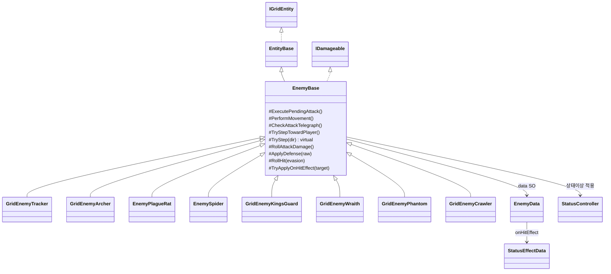

# 적(Enemy) 시스템 설정 가이드

> [!NOTE]
> Phase 0 리팩토링 완료 후 새 적을 추가하는 방법을 설명합니다.
> 관련 TODO: [enemy_refactor_todo.md](./enemy_refactor_todo.md)

---

## 1. 아키텍처 개요



### 핵심 흐름: 템플릿 메서드 패턴

`EnemyBase.OnTurnUpdate()`는 매 턴 3단계로 실행됩니다:

```
1. ExecutePendingAttack()  — 이전 턴 예고한 공격 발동
2. PerformMovement()       — 이동 처리
3. CheckAttackTelegraph()  — 다음 턴 공격 예고
```

각 단계는 `protected virtual`이므로 자식 클래스에서 필요한 부분만 override 가능합니다.

---

## 2. 새 적 추가 — 단계별 가이드

### Step 1: EnemyData SO 생성

Unity 에디터에서:
1. `Assets/KKH/04. SOData/` 폴더에서 **우클릭 → Create → 60s Dungeon → Enemy Data**
2. 인스펙터에서 값 설정:

| 필드 | 설명 | 예시 (역병 쥐) |
|------|------|----------------|
| `id` | 고유 식별자 | `plague_rat` |
| `displayName` | 표시명 | `역병 쥐` |
| `sprite` | 스프라이트 | (할당) |
| `grade` | Common/Elite/MiniBoss/Boss | `Common` |
| `moveType` | Normal/WallPass/Stationary | `Normal` |
| `maxHp` | 최대 체력 | `8` |
| `attackMin` / `attackMax` | 공격력 범위 | `2` / `4` |
| `attackPattern` | Melee/Ranged | `Melee` |
| `moveSpeed` | 이동 속도 (초/칸) | `1.0` |
| `attackSpeed` | 공격 속도 (회/s) | `1.0` |
| `defenseMin` / `defenseMax` | 방어력 범위 | `0` / `0` |
| `evasion` | 회피 | `5` |
| `accuracy` | 정확도 | `10` |
| `timeBonus` | 처치 시간 보너스 | `3` |
| `expReward` | 경험치 | `5` |
| `goldMin` / `goldMax` | 골드 드롭 범위 | `0` / `0` |
| `visionRange` | 감지 거리 | `6` |
| `onHitEffect` | 명중 시 상태이상 SO | (Poison SO 할당) |

### Step 2: StatusEffectData SO 생성 (필요한 경우)

명중 시 상태이상이 있는 적만 해당합니다.

1. `Assets/KKH/04. SOData/` 에서 **우클릭 → Create → 60s Dungeon → Status Effect Data**
2. 설정:

| 필드 | 설명 | 예시 (독) |
|------|------|-----------|
| `statusType` | 기존 StatusType enum 사용 | `Poison` |
| `durationTurns` | 지속 턴 수 | `5` |
| `power` | 틱당 데미지/효과 강도 | `1` |
| `moveSpeedPenalty` | 이동속도 패널티 (초) | `0` |

3. 생성한 SO를 EnemyData의 `onHitEffect` 필드에 할당

### Step 3: C# 스크립트 생성

`Assets/KKH/02. Scripts/Enemies/` 에 스크립트 생성.

#### 케이스 A: 기본 추적 + 근접 공격 (코드 0줄)

Tracker/역병 쥐처럼 EnemyBase 기본 동작 그대로라면:

```csharp
public class EnemyPlagueRat : EnemyBase
{
    // EnemyBase 기본 OnTurnUpdate 사용 — override 불필요
    // 독 효과는 SO의 onHitEffect에서 자동 적용
}
```

#### 케이스 B: 특수 공격만 다른 경우 (거미)

ExecutePendingAttack만 override:

```csharp
public class EnemySpider : EnemyBase
{
    [SerializeField] private StatusEffectData slowDebuffData;

    protected override void ExecutePendingAttack()
    {
        if (_pendingAttackCell.HasValue && Player.GridPosition == _pendingAttackCell.Value)
        {
            int damage = RollAttackDamage();
            Player.TakeDamage(damage);
            TryApplyOnHitEffect(Player);    // 독
            // 추가 디버프 적용 로직
        }
        _pendingAttackCell = null;
        ClearTelegraphs();
    }
}
```

#### 케이스 C: 특수 이동만 다른 경우 (벽 통과)

TryStep만 override:

```csharp
public class GridEnemyWraith : EnemyBase
{
    protected override bool TryStep(Vector2Int dir)
    {
        var next = GridPosition + dir;
        if (next == Player.GridPosition) return false;
        if (TurnManager.Instance.GetEntityAt(next) != null) return false;
        SetGridPosition(next);
        UpdateVisibility();
        return true;  // IsWalkable 체크 생략 → 벽 통과
    }
}
```

#### 케이스 D: 고속 이동 (Crawler 패턴)

PerformMovement만 override:

```csharp
protected override void PerformMovement()
{
    // 한 턴에 N칸 논리 이동 + 시각 보간
}
```

#### 케이스 E: 완전히 다른 AI (Archer, 보스 등)

OnTurnUpdate 전체 override:

```csharp
public override void OnTurnUpdate()
{
    if (IsDead || Player == null) return;
    // 완전 커스텀 로직
}
```

### Step 4: 프리팹 생성

1. 빈 GameObject 생성 → 이름 설정 (예: `PlagueRat`)
2. `SpriteRenderer` 자동 추가됨 (EntityBase의 RequireComponent)
3. 스크립트 컴포넌트 추가 (예: `EnemyPlagueRat`)
4. 인스펙터에서 할당:
   - `data` → EnemyData SO 할당
   - `telegraphPrefab` → TelegraphIndicator 프리팹 할당
   - (거미의 경우) `slowDebuffData` → StatusEffectData SO 할당
5. `Assets/KKH/03. Prefab/` 에 프리팹으로 저장

### Step 5: 스폰 테이블 등록

`Assets/KKH/04. SOData/TestSpawnTable.asset` 또는 해당 Area의 스폰 테이블에 새 적의 프리팹/데이터를 등록합니다.

---

## 3. 현재 구현된 적 목록

### 기존 적 (리팩토링 완료)

| 이름 | 클래스 | 위치 | 특수 능력 | override 항목 |
|------|--------|------|-----------|---------------|
| 추적자 | `GridEnemyTracker` | KDU | 없음 (기본 추적) | 없음 |
| 사수 | `GridEnemyArcher` | KDU | 4방향 직선 사격 | `OnTurnUpdate` 전체 |
| 근위병 | `GridEnemyKingsGuard` | KKH | 2턴 1행동, 피해감소 | `OnTurnUpdate` 전체 |
| 망령 | `GridEnemyWraith` | KKH | 벽 통과 이동 | `TryStep` |
| 팬텀 | `GridEnemyPhantom` | KKH | 사망 시 분열 | `Die` |
| 크롤러 | `GridEnemyCrawler` | KKH | 한 턴 2칸 이동 | `PerformMovement` |

### Phase 1 신규 적

| 이름 | 클래스 | 등급 | 특수 능력 | override 항목 |
|------|--------|------|-----------|---------------|
| 역병 쥐 | `EnemyPlagueRat` | Common | 독 (onHitEffect SO) | 없음 |
| 거미 | `EnemySpider` | Common | 독 + 이동속도 감소 | `ExecutePendingAttack` |

---

## 4. EnemyBase 제공 메서드 요약

### 이동 관련

| 메서드 | 설명 | virtual |
|--------|------|---------|
| `TryStepTowardPlayer()` | 플레이어 방향 1칸 이동 | ✗ |
| `TryStep(dir)` | 지정 방향 1칸 이동 (벽체크) | ✔ |

### 전투 관련

| 메서드 | 설명 |
|--------|------|
| `RollAttackDamage()` | attackMin~attackMax 랜덤 데미지 |
| `ApplyDefense(rawDamage)` | 방어력 적용 후 최종 데미지 |
| `RollHit(targetEvasion)` | 명중 판정 (accuracy vs evasion) |
| `TryApplyOnHitEffect(target)` | onHitEffect SO의 상태이상 적용 |

### 텔레그래프

| 메서드 | 설명 |
|--------|------|
| `ShowTelegraph(cell)` | 해당 셀에 공격 예고 표시 |
| `ClearTelegraphs()` | 모든 텔레그래프 제거 |

### 유틸리티

| 메서드 | 설명 |
|--------|------|
| `IsAdjacentToPlayer()` | 맨해튼 거리 1 여부 |
| `SquaredDistanceToPlayer()` | 제곱 거리 (시야 비교용) |
| `UpdateVisibility()` | 시야 기반 렌더러 on/off |

---

## 5. SO 인스턴스 생성 가이드 (Phase 1 예시)

### 역병 쥐 — EnemyData SO

```
파일명: PlagueRat.asset
위치: Assets/KKH/04. SOData/

id:            plague_rat
displayName:   역병 쥐
grade:         Common
moveType:      Normal
maxHp:         8
attackMin:     2
attackMax:     4
attackPattern: Melee
moveSpeed:     1.0
attackSpeed:   1.0
defenseMin:    0
defenseMax:    0
evasion:       5
accuracy:      10
timeBonus:     3
expReward:     5
goldMin:       0
goldMax:       0
visionRange:   6
onHitEffect:   → Poison_5t_1p.asset (아래 참조)
```

### 역병 쥐 — StatusEffectData SO (독)

```
파일명: Poison_5t_1p.asset
위치: Assets/KKH/04. SOData/

statusType:       Poison
durationTurns:    5
power:            1
moveSpeedPenalty: 0
```

### 거미 — EnemyData SO

```
파일명: Spider.asset
위치: Assets/KKH/04. SOData/

id:            spider
displayName:   거미
grade:         Common
moveType:      Normal
maxHp:         6
attackMin:     2
attackMax:     3
attackPattern: Melee
moveSpeed:     1.0
attackSpeed:   1.0
defenseMin:    0
defenseMax:    0
evasion:       8
accuracy:      12
timeBonus:     3
expReward:     5
goldMin:       0
goldMax:       0
visionRange:   6
onHitEffect:   → Poison_5t_1p.asset (역병 쥐와 공유 가능)
```

### 거미 — StatusEffectData SO (이동속도 감소)

```
파일명: Cripple_2t_1p.asset
위치: Assets/KKH/04. SOData/

statusType:       Cripple
durationTurns:    2
power:            1
moveSpeedPenalty: 0.3
```

> [!IMPORTANT]
> 거미의 `EnemySpider` 컴포넌트 인스펙터에서 `slowDebuffData` 필드에
> `Cripple_2t_1p.asset`을 직접 할당해야 합니다.

---

## 6. GameEvents 변경 사항

Phase 0에서 추가된 이벤트:

| 이벤트 | 시그니처 | 발행 시점 |
|--------|----------|-----------|
| `OnExpDropped` | `Action<Vector2Int, int>` | 적 사망 시 (위치, 경험치) |
| `OnGoldDropped` | `Action<Vector2Int, int>` | 적 사망 시 골드 > 0일 때 |
| `OnStatusEffectApplied` | `Action<StatusRequest>` | 상태이상 적용 시 |

이 이벤트를 UI/사운드에서 구독하면 보상 드롭 연출 가능.

---

## 7. 기존 SO 마이그레이션 안내

기존 `attackDamage` 필드는 `attackMin`/`attackMax`로 대체되었습니다.
하위호환 프로퍼티 `attackDamage`가 `(attackMin + attackMax) / 2`를 반환하므로
기존 코드는 **즉시 깨지지 않습니다**.

하지만 기존 SO 인스턴스(`Crawler.asset`, `KingsGuard.asset` 등)는
Unity에서 열면 새 필드가 기본값(0)으로 나타납니다.

**마이그레이션 절차:**
1. 각 `.asset` 파일을 Unity 인스펙터에서 열기
2. 기존 `attackDamage` 값을 `attackMin`/`attackMax`에 분배
   - 예: `attackDamage=10` → `attackMin=8`, `attackMax=12`
3. 나머지 새 필드 (evasion, accuracy, expReward 등) 적절히 설정

---

## 8. 파일 위치 요약

```
Assets/
├── KDU/01.Scripts/
│   ├── Data/
│   │   ├── EnemyData.cs          ← Phase 0 확장 완료
│   │   └── StatusEffectData.cs   ← Phase 0 신규
│   ├── Events/
│   │   └── GameEvents.cs         ← Phase 0 확장 완료
│   └── Grid/Enemies/
│       ├── GridEnemyTracker.cs   ← 리팩토링 완료
│       ├── GridEnemyArcher.cs    ← 리팩토링 완료
│       └── GridEnemyBase.cs      ← [폐기됨] 빈 래퍼
├── LSH/02. Scripts/Boss/
│   └── EnemyBase.cs              ← Phase 0 확장 완료 (핵심)
└── KKH/02. Scripts/Enemies/
    ├── GridEnemyKingsGuard.cs    ← 리팩토링 완료
    ├── GridEnemyWraith.cs        ← 리팩토링 완료
    ├── GridEnemyPhantom.cs       ← 리팩토링 완료
    ├── GridEnemyCrawler.cs       ← 리팩토링 완료
    ├── EnemyPlagueRat.cs         ← Phase 1 신규
    └── EnemySpider.cs            ← Phase 1 신규
```

---

## 9. 자주 묻는 질문

### Q: 상태이상은 어떻게 적용되나요?
기존 NYH의 `StatusController` + `StatusType` 시스템을 그대로 재활용합니다.
`TryApplyOnHitEffect()`가 대상에 `StatusController` 컴포넌트가 없으면 자동 추가합니다.

### Q: 기존 `data.attackDamage`를 쓰는 코드가 깨지나요?
아닙니다. `attackDamage` 프로퍼티가 `(attackMin + attackMax) / 2`를 반환합니다.
하지만 범위 데미지를 원하면 `RollAttackDamage()`를 사용하세요.

### Q: 새 적을 만들 때 코드를 꼭 짜야 하나요?
기본 추적 + 근접 공격 적이면 빈 클래스 1개면 됩니다. 특수 능력은 SO로 처리.

### Q: Wraith처럼 벽을 통과하는 적을 추가하려면?
`TryStep`만 override하여 `IsWalkable` 체크를 제거하면 됩니다. `moveType`을 `WallPass`로 설정.
