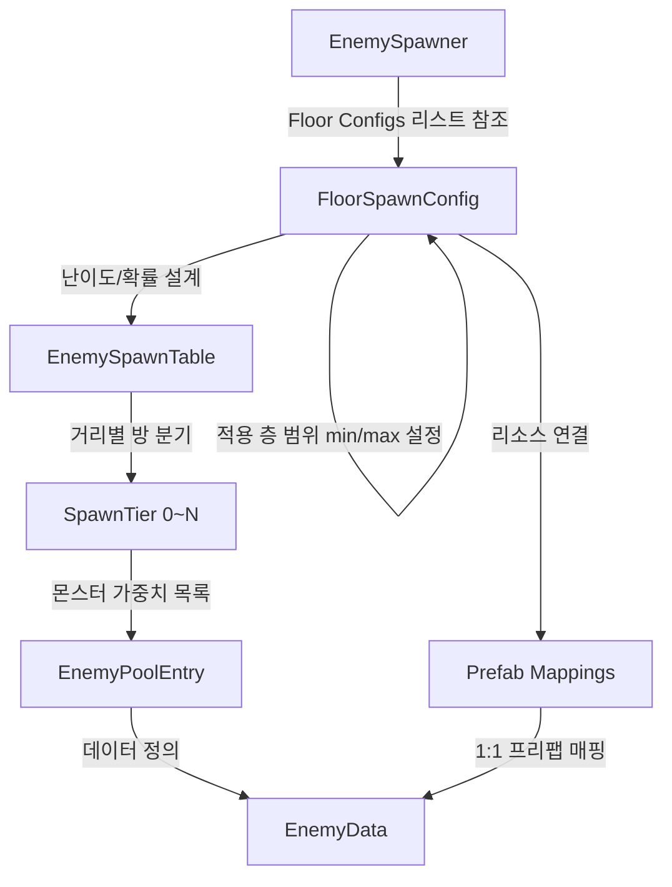
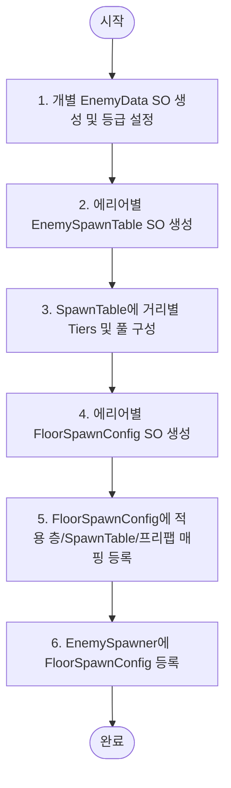

# 에리어별 몬스터 스폰 시스템 SO 설정 가이드

본 문서는 던전의 각 에리어(Area)별로 출현하는 일반 및 엘리트 몬스터를 다양하게 교체하고 관리하기 위한 ScriptableObject(SO) 설정 절차를 안내합니다.

---

## 1. 스폰 시스템 구조도

스폰 시스템은 아래와 같은 데이터 흐름과 의존성 관계를 가집니다.

---

## 2. 에리어별 스폰 설정 순서도

새로운 에리어를 구성하고 스폰 몬스터를 교체하는 작업의 흐름입니다.

---

## 3. 단계별 세부 설정 가이드

### 1단계: 개별 몬스터 데이터 정의 (`EnemyData`)

* **역할**: 개별 몬스터의 능력치(HP, 공격력, 스피드), 보상, 시야 범위, 그리고 등급(`Grade`)을 설정하는 원천 데이터입니다.
* **설정 방법**:
  1. Project 뷰에서 우클릭 ➔ `Create` ➔ `60s Dungeon` ➔ `Enemy Data` 선택.
  2. 생성된 SO의 인스펙터에서 몬스터 기본 정보 및 등급(`Grade` ➔ `Common` 또는 `Elite`)을 설정합니다.
  3. **주의**: 에리어별 엘리트 몬스터(Area 1의 뱀 등)는 반드시 `Grade`를 **`Elite`**로 지정해야 합니다.

### 2단계: 에리어별 스폰 테이블 구성 (`EnemySpawnTable`)

* **역할**: 안전 구역(Safe Room)으로부터의 거리에 비례하여 몬스터 풀(Pool)과 난이도 곡선(Tiers)을 설계합니다.
* **설정 방법**:
  1. Project 뷰에서 우클릭 ➔ `Create` ➔ `60s Dungeon` ➔ `Enemy Spawn Table` 선택.
  2. 생성된 SO의 인스펙터에서 **`Tiers`** 배열을 구성합니다.
     * **Tiers[0]**: Safe Room 그래프 거리 1인 인접 방들에 등장할 풀 (가장 약한 몬스터)
     * **Tiers[1]**: Safe Room 그래프 거리 2인 방들의 풀
     * **Tiers[최종]**: 가장 깊은 방들 및 **출구 방(Exit Room)에서 참조할 최종 난이도 풀**.
     * **중요**: 최종 티어 풀에 **해당 에리어의 엘리트 몬스터(예: 뱀)**를 반드시 등록해주어야 사전 검출을 통해 출구 방에 1마리 확정 소환됩니다.

### 3단계: 층 범위 및 프리팹 매핑 설정 (`FloorSpawnConfig`)

* **역할**: 에리어의 범위(층수)를 지정하고, 몬스터의 데이터(`EnemyData`)와 실제 게임오브젝트 리소스(`Prefab`)를 1:1로 매핑합니다.
* **설정 방법**:
  1. Project 뷰에서 우클릭 ➔ `Create` ➔ `60s Dungeon` ➔ `Floor Spawn Config` 선택.
  2. **`Min/Max Depth`**를 지정합니다. (예: Area 1은 1~5층, Area 2는 6~10층)
  3. **`Spawn Table`** 항목에 2단계에서 만든 에리어용 `EnemySpawnTable` SO를 드래그앤드롭합니다.
  4. **`Prefab Mappings`** 리스트에 해당 에리어에 등장하는 모든 몬스터의 `EnemyData` SO와 실제 구현된 `GameObject Prefab`을 등록합니다. (엘리트 몬스터 포함 필수)

### 4단계: 총괄 스포너 등록 (`EnemySpawner`)

* **역할**: 던전 씬 전체의 스폰을 지휘하는 스포너 컴포넌트에 최종 설정을 로드합니다.
* **설정 방법**:
  1. 씬에 배치된 **`EnemySpawner`** 게임오브젝트를 선택합니다.
  2. 인스펙터의 **`Floor Configs`** 리스트에 3단계에서 생성한 각 에리어별 `FloorSpawnConfig` SO 파일들을 순서대로 등록합니다.
  3. 이제 게임 실행 시 플레이어가 위치한 현재 층(`depth`) 정보에 맞춰 알맞은 에리어용 설정이 자동으로 스위칭되어 몬스터가 생성됩니다.
