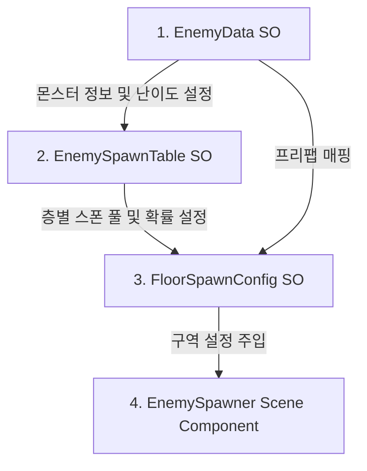

# 적(Enemy) 스폰 시스템 에디터 설정 가이드

본 문서는 유니티 에디터 상에서 몬스터 데이터 생성부터 구역(층)별 스폰 설정, 그리고 실제 씬의 스파우너 배치까지 적 스폰 시스템 전반을 설정하고 유지보수하기 위한 가이드라인입니다.

---

## 1. 스폰 시스템 구조 개요

스폰 시스템은 **데이터와 프리팹(시각 요소)의 분리** 및 **층별 유지보수성**을 보장하기 위해 다음과 같은 흐름으로 엮여 있습니다.

1.  **EnemyData (SO)**: 몬스터 1종의 스탯 및 등급 정보 정의.
2.  **EnemySpawnTable (SO)**: Safe Room으로부터의 거리별 등장할 몬스터 풀과 수량 정의.
3.  **FloorSpawnConfig (SO)**: 특정 층 범위 내에서 적용할 `EnemySpawnTable`, 보스 정보, 그리고 **`EnemyData ↔ 프리팹`** 매핑 관리.
4.  **EnemySpawner (Scene Component)**: 맵 생성기로부터 신호를 받아 현재 층에 알맞은 `FloorSpawnConfig`를 찾아 생성 수행.

---

## 2. 에디터 설정 단계

### [Step 1] 개별 몬스터 데이터 (EnemyData SO) 생성
새로운 몬스터를 시스템에 등록하기 위해 기초 데이터를 생성합니다.

1.  프로젝트 뷰에서 우클릭 → **`Create -> 60s Dungeon -> Enemy Data`** 클릭.
2.  생성된 파일명을 몬스터 이름으로 변경 (예: `Spider.asset`).
3.  인스펙터 창에서 다음 필수 항목을 설정합니다:
    *   **id**: 시스템 구분용 고유 문자열 (소문자/언더바 권장, 예: `spider`).
    *   **DisplayName**: 게임 상에 노출될 이름.
    *   **Max Hp / Attack Min & Max**: 체력 및 데미지 범위 설정.
    *   **Move Speed**: 이동 속도 (숫자가 낮을수록 한 칸 이동 소요 시간이 짧아 빨라짐).
    *   **Grade / Move Type**: 일반/엘리트 여부 및 이동 제약 타입 설정.
    *   **Time Bonus**: 처치 시 늘어날 보너스 제한 시간(초).

---

### [Step 2] 층별 스폰 난이도 테이블 (EnemySpawnTable SO) 설정
Safe Room으로부터의 거리에 따른 스폰 난이도 곡선을 구성합니다.

1.  프로젝트 뷰에서 우클릭 → **`Create -> 60s Dungeon -> Enemy Spawn Table`** 클릭.
2.  파일명 설정 (예: `Area1_Sewer_SpawnTable.asset`).
3.  인스펙터의 **Tiers** 배열을 구성합니다. (인덱스는 `Safe Room으로부터의 거리 - 1`입니다):
    *   **Tier 0 (인덱스 0)**: Safe Room 바로 옆방 (거리 1) 난이도.
    *   **Tier 1 (인덱스 1)**: 거리 2 난이도.
    *   **Tier 2 (인덱스 2)**: 거리 3 난이도.
    *   **Tier 3 (인덱스 3)**: 거리 4 이상 구역 난이도.
4.  각 Tier의 상세 항목을 조절합니다:
    *   **Min / Max Count**: 방당 스폰될 최소/최대 마리 수.
    *   **Elite Chance**: 해당 방에서 엘리트 등급으로 강화되어 나올 확률 (0 ~ 1).
    *   **Pool**: 등장 가능한 몬스터 리스트.
        *   **Enemy Data**: Step 1에서 만든 `EnemyData` SO 할당.
        *   **Weight**: 등장 가중치 (수치가 높을수록 해당 티어에서 자주 선택됨).
        *   **Requires Line Of Sight**: **궁수(Archer)형 몬스터 설정 필수.** 체크 시, 4방향 직선 시야(LOS)가 3칸 이상 확보되는 위치에만 스폰됩니다. (스폰 실패 시 다른 몬스터로 강등 또는 위치 재탐색)

---

### [Step 3] 층별 구성 설정 (FloorSpawnConfig SO) 작성
구역 테마에 쓰일 스폰 테이블과 프리팹(게임오브젝트)을 하나로 묶습니다.

1.  프로젝트 뷰에서 우클릭 → **`Create -> 60s Dungeon -> Floor Spawn Config`** 클릭.
2.  파일명 설정 (예: `FloorConfig_Area1.asset`).
3.  인스펙터 항목 설정:
    *   **Spawn Table**: Step 2에서 만든 `EnemySpawnTable` SO를 등록합니다.
    *   **Boss Data**: 보스방 출현 층일 경우 생성할 보스의 `EnemyData` SO를 등록합니다 (옵션).
    *   **Prefab Mappings**: 해당 구역에 등장하는 몬스터들의 프리팹을 매핑합니다.
        *   `Enemy Data` 목록에 몬스터 SO를 드래그하고, 우측 `Prefab` 칸에 실제 씬에 복제될 몬스터 프리팹을 할당합니다.
        *   **주의**: 여기에 매핑이 누락되면 해당 몬스터 스폰 시 경고 로그가 남으며 생성이 생략됩니다.

---

### [Step 4] 씬 내 스파우너 (EnemySpawner) 세팅
런타임에 현재 층 수(Depth)를 감지해 알맞은 에셋을 불러오도록 설정합니다.

1.  게임이 진행되는 씬에서 `EnemySpawner` 스크립트가 부착된 게임오브젝트를 찾습니다 (또는 신설).
2.  인스펙터의 **Floor Configs** 리스트에 필요한 구역 개수만큼 요소를 추가합니다:
    *   **Min / Max Depth**: 해당 설정이 적용될 층 구간을 지정합니다.
        *   *예시 (5층 단위 구역 테마 적용)*:
            *   Element 0: Min Depth = 1, Max Depth = 5 / Config = `FloorConfig_Area1`
            *   Element 1: Min Depth = 6, Max Depth = 10 / Config = `FloorConfig_Area2`
    *   **Config**: Step 3에서 완성한 `FloorSpawnConfig` 에셋을 드래그하여 할당합니다.

---

## 3. 맵 스폰 규칙 및 제약 사항

시스템이 자동으로 검증하여 적용하는 기획상 제약 사항입니다. (설정 시 참고용)

*   **즉사 방지 완충 지대**: 모든 방의 입구(Door Cell) 주변 1칸 범위 내에는 몬스터가 절대 생성되지 않습니다.
*   **통로(Tunnel) 스폰 금지**: 방과 방을 잇는 좁은 복도 영역에는 몬스터가 배치되지 않습니다.
*   **보스 방 중앙 배치**: 보스방에서는 방의 중심 위치(혹은 가장 가까운 바닥 타일)에 보스가 확정 1마리 스폰됩니다.
*   **궁수 제약**: `Requires Line Of Sight`가 활성화된 적은 벽이나 장애물이 없는 직선 시야(3칸 이상)가 확보된 셀에 배치됩니다. 만약 방에 조건을 만족하는 셀이 더 이상 없다면 생성이 취소됩니다.

---

## 4. 에디터 스폰 시뮬레이션 테스트

게임을 직접 플레이하지 않고도 기획한 스폰률과 난이도가 정상 작동하는지 테스트할 수 있습니다.

1.  씬 안에 임의의 빈 오브젝트를 생성하고 `EnemySpawnTester` 스크립트를 부착합니다.
2.  `EnemySpawnTester` 인스펙터에 테스트하고 싶은 **Spawn Table**과 **Prefab Mappings**를 할당합니다.
3.  **가상 방 설정 (Test Room Type, Distance From Safe, Room Size)**을 수정합니다.
4.  스크립트 컴포넌트 우측 상단의 점 3개 메뉴(또는 컴포넌트 하단)에서 **`스폰 테스트 실행 (가상 방 생성 및 적 스폰)`** ContextMenu를 클릭합니다.
5.  씬 뷰에 기획 의도대로 몬스터가 정상 비율로 잘 깔리는지 확인합니다.
