# 🗡️ 적(Enemy) 시스템 — 핵심 구조 발표 자료

> **60초 던전** | 적 시스템 담당: KKH  
> 마지막 업데이트: 2025-05-25

---

## 목차

1. [시스템 전체 구조 개요](#1-시스템-전체-구조-개요)
2. [데이터 중심 설계 (ScriptableObject)](#2-데이터-중심-설계-scriptableobject)
3. [스폰 파이프라인](#3-스폰-파이프라인)
4. [턴 흐름 — 적의 한 턴](#4-턴-흐름--적의-한-턴)
5. [전투 판정 시스템](#5-전투-판정-시스템)
6. [개별 적 AI 패턴](#6-개별-적-ai-패턴)
7. [애니메이션 연동](#7-애니메이션-연동)
8. [이벤트 기반 통신](#8-이벤트-기반-통신)
9. [확장성 — 새 몬스터 추가 방법](#9-확장성--새-몬스터-추가-방법)

---

## 1. 시스템 전체 구조 개요

적 시스템은 **"데이터(SO) → 스폰 → 턴 행동 → 소멸"** 의 생명주기로 동작합니다.

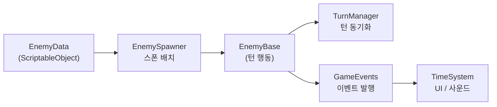

### 핵심 설계 원칙

| 원칙 | 설명 |
|------|------|
| **데이터-로직 분리** | 적의 수치(`EnemyData` SO)와 행동 코드(`EnemyBase` 파생 클래스)를 완전 분리 |
| **템플릿 메서드 패턴** | 공통 턴 흐름은 `EnemyBase`가 담당, 파생 클래스는 필요한 단계만 override |
| **이벤트 기반 통신** | 적 사망/경험치/골드 등을 `GameEvents` 정적 이벤트로 발행 → UI·사운드·타임 보너스가 구독 |
| **ScriptableObject 우선** | 새 적 = SO 인스턴스 생성 + 프리팹 연결. 코드 수정 최소화 |

---

## 2. 데이터 중심 설계 (ScriptableObject)

### EnemyData — 적 1종의 모든 수치를 정의

```
Assets/KDU/01.Scripts/Data/EnemyData.cs
```

```csharp
[CreateAssetMenu(menuName = "60s Dungeon/Enemy Data")]
public class EnemyData : ScriptableObject
{
    // 기본 정보
    public string id;
    public string displayName;
    public Sprite sprite;

    // 등급 / 타입
    public EnemyGrade grade;       // Common, Elite, MiniBoss, Boss
    public EnemyMoveType moveType; // Normal, WallPass, Stationary
    public bool hasShield;

    // 전투 스탯
    public int maxHp;
    public int attackMin, attackMax;
    public float moveSpeed;     // 초/칸 (낮을수록 빠름)
    public float attackSpeed;   // 회/초
    public int defenseMin, defenseMax;
    public int evasion, accuracy;

    // 보상
    public float timeBonus;     // 처치 시 추가 시간
    public int expReward;
    public int goldMin, goldMax;

    // 기타
    public float visionRange;
    public StatusEffectData onHitEffect; // 명중 시 상태이상
}
```

> **핵심 포인트**: 디자이너가 **Unity 인스펙터에서 수치만 조정**하면 밸런싱 가능.  
> 코드 수정 없이 새 적 종류를 추가할 수 있는 구조.

### 데이터 흐름 다이어그램

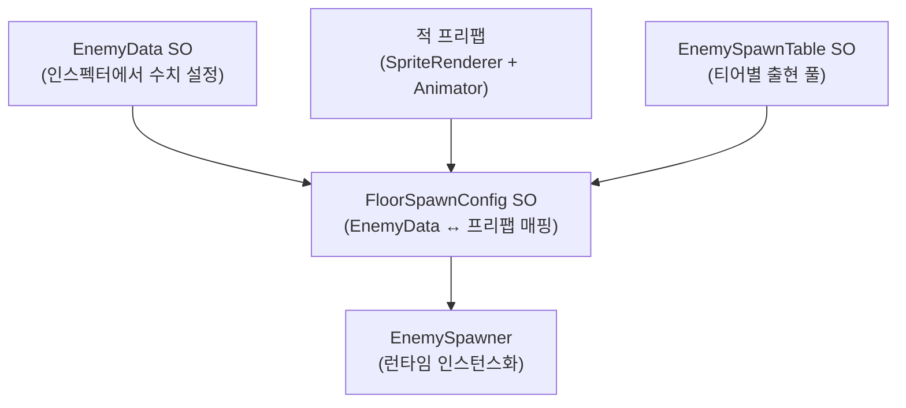

---

## 3. 스폰 파이프라인

적이 맵에 배치되기까지의 전체 흐름입니다.

### 3.1 관련 클래스 구조

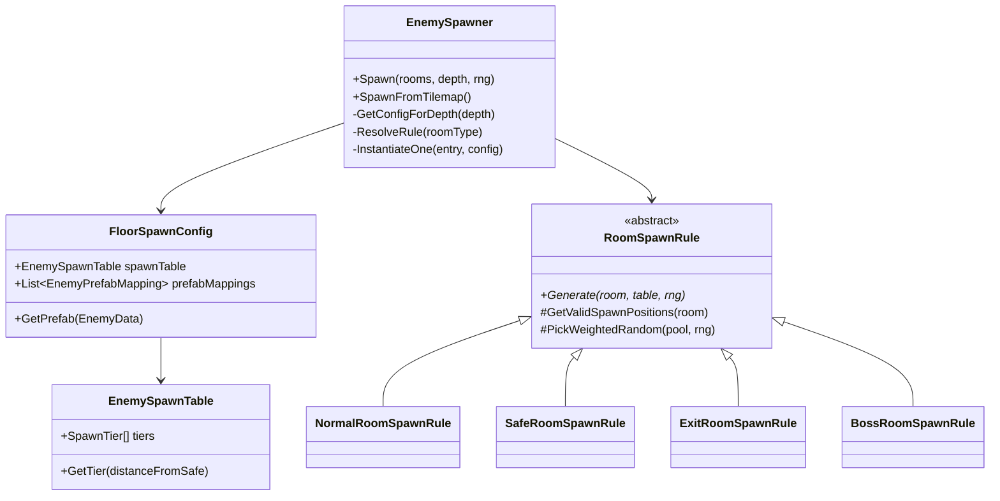

### 3.2 스폰 단계 흐름

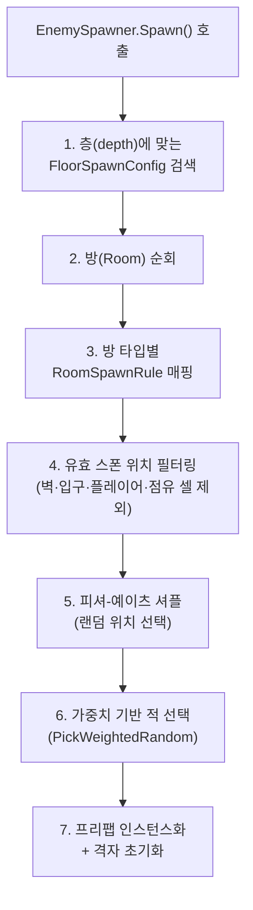

### 3.3 방 타입별 스폰 규칙

| 방 타입 | 규칙 | 스폰 수 |
|---------|------|---------|
| **Safe** | 스폰 없음 (타이머 정지 구역) | 0 |
| **Normal** | `distanceFromSafe` 기준 난이도 티어 적용 | 방 크기 × 티어 범위 |
| **Exit** | 항상 최고 티어, 최소 2체 보장 | 2+ |
| **Boss** | 방 중앙에 보스 1체 배치 | 1 |

### 3.4 스폰 수량 결정 공식

```
baseCount = rng.Range(tier.minCount, tier.maxCount + 1)

방 크기 보정:
  Normal  → ×1.0
  Large   → ×1.5
  Giant   → ×2.0

외부 보정 (FloorFeeling 등):
  finalCount = baseCount + SpawnCountModifier

최종 캡: min(finalCount, 유효 위치 수)
```

---

## 4. 턴 흐름 — 적의 한 턴

`TurnManager`가 등록된 모든 적의 `OnTurnUpdate()`를 순차 호출합니다.

### 4.1 템플릿 메서드 패턴 (핵심)

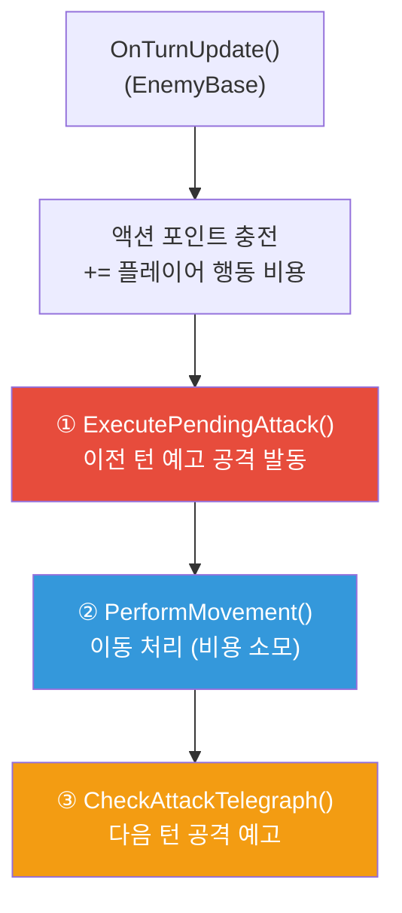

### 4.2 세 단계 상세

#### ① ExecutePendingAttack — 공격 발동 (빨간색)

```
이전 턴에 예고(`_pendingAttackCell`)한 공격이 있으면:
  → 플레이어가 해당 셀에 있으면 → 데미지 적용 + 상태이상
  → 텔레그래프 제거
```

> 💡 **텔레그래프 시스템**: 적은 공격 전 반드시 1턴 전에 "여기를 공격하겠다"고 표시  
> → 플레이어에게 **회피할 기회** 제공 (Into the Breach 참고)

#### ② PerformMovement — 이동 (파란색)

```
이동 비용(moveSpeed) ≤ 축적 포인트 → 이동 실행
  기본: TryStepTowardPlayer() (가까운 축 우선 1칸)
  고속 적: 2칸 이동 (Bat, GoblinThief)
```

#### ③ CheckAttackTelegraph — 공격 예고 (주황색)

```
공격 비용 ≤ 축적 포인트이고, 플레이어가 인접하면:
  → _pendingAttackCell = 플레이어 위치
  → 텔레그래프 표시 (빨간 타일)
```

### 4.3 액션 포인트 시스템

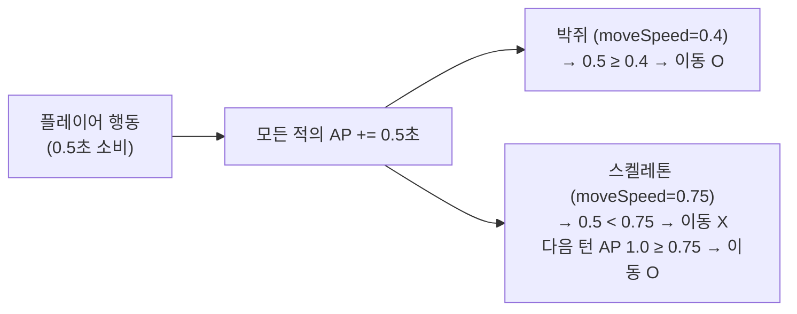

> **결과**: 빠른 적은 **매 턴 이동**, 느린 적은 **가끔 이동** → 체감 속도 차이 자연스럽게 구현

---

## 5. 전투 판정 시스템

### 5.1 데미지 계산 흐름

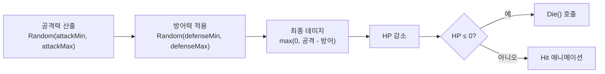

### 5.2 명중 판정

```
hitChance = clamp(0.5 + (accuracy - evasion) × 0.05, 0.05, 0.95)
```

| accuracy - evasion | 명중률 |
|:-:|:-:|
| -9 이하 | 5% (최저) |
| 0 | 50% |
| +9 이상 | 95% (최고) |

### 5.3 사망 처리 흐름

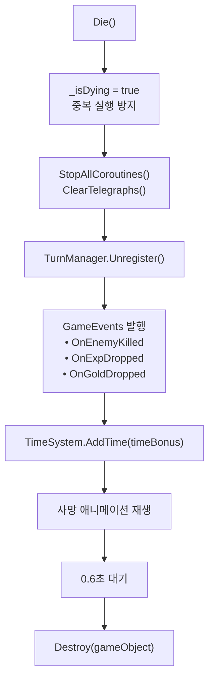

---

## 6. 개별 적 AI 패턴

### 클래스 상속 구조

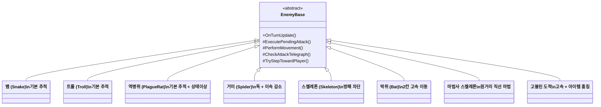

### 적별 행동 비교표

| 적 | 이동 | 공격 | 특수 능력 | override 메서드 |
|---|---|---|---|---|
| **🐍 뱀** | 기본 1칸 추적 | 근접 1칸 | — | 없음 (기본 사용) |
| **🧌 트롤** | 기본 1칸 추적 | 근접 1칸 | — | 없음 (기본 사용) |
| **🐀 역병쥐** | 기본 1칸 추적 | 근접 1칸 | 명중 시 상태이상 (onHitEffect SO) | 없음 (기본 사용) |
| **🕷️ 거미** | 기본 1칸 추적 | 근접 1칸 | 독 + 이속 감소 (이중 디버프) | `ExecutePendingAttack` |
| **💀 스켈레톤** | 기본 (느림 0.75) | 근접 1칸 | 50% 확률 방패 (0~2 추가 감소) | `OnTurnUpdate`, `TakeDamage` |
| **🦇 박쥐** | **2칸 고속** (보간) | 근접 1칸 | — | `PerformMovement` |
| **🧙 마법사** | 조건부 추적 | **원거리 직선** | 방패(선택), 직선 LOS 마법 | 전 단계 override |
| **👺 고블린 도적** | **2칸 고속** (보간) | 근접 1칸 | 아이템 훔침 → **도주 AI** | 이동+공격+사망 |

### 주요 AI 패턴 상세

#### 🦇 박쥐 — 고속 이동

```
한 턴에 TryStepLogical() × 2회 호출
→ 논리 좌표 즉시 갱신
→ SmoothMoveVisual() 코루틴으로 시각 보간
```

#### 🧙 마법사 스켈레톤 — 원거리 마법

```
1. 4방향 직선에 플레이어가 있는지 ComputeLineToPlayer()
2. 있으면 → 직선 전체에 텔레그래프 표시 (이동 안 함)
3. 없으면 → 플레이어 방향으로 추적 이동
4. 다음 턴 → 직선 범위 내 플레이어에게 데미지
```

#### 👺 고블린 도적 — 아이템 도둑

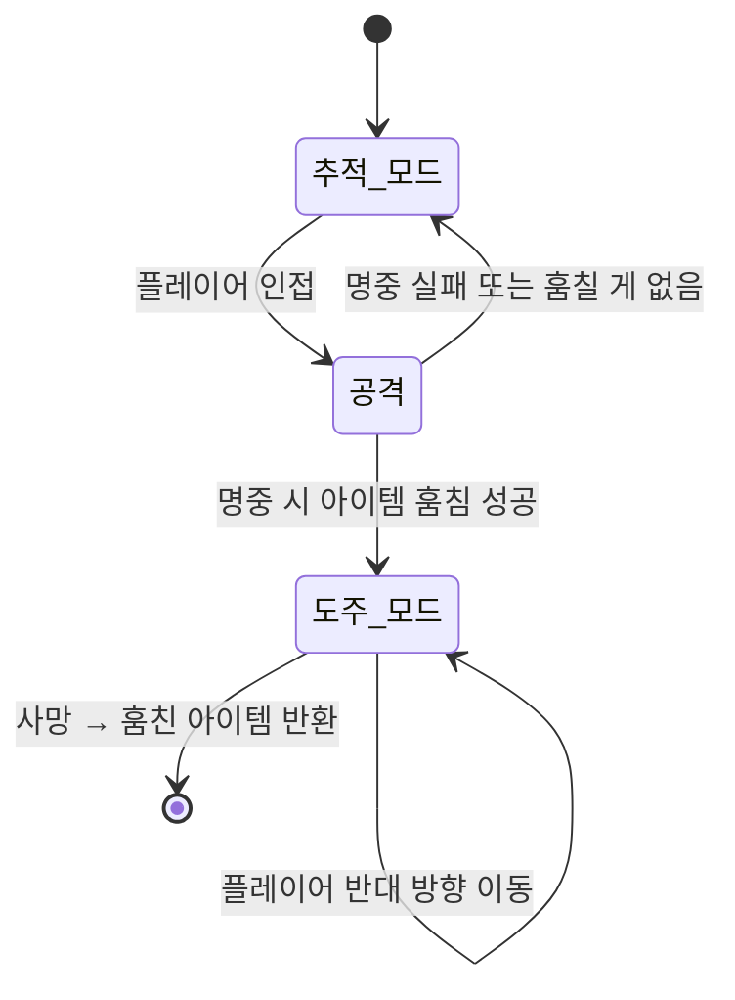

---

## 7. 애니메이션 연동

### 7.1 Animator 파라미터

| 파라미터 | 타입 | 트리거 시점 |
|---------|------|-----------|
| `Walk` | **Bool** | 이동 시 true → 이동 완료 후 false |
| `Attack` | **Trigger** | 공격 발동 시 (ExecutePendingAttack) |
| `Hit` | **Trigger** | 피격 시 (HP > 0일 때) |
| `Die` | **Trigger** | 사망 시 (PlayDeathAnimation) |

### 7.2 Animator 상태 흐름

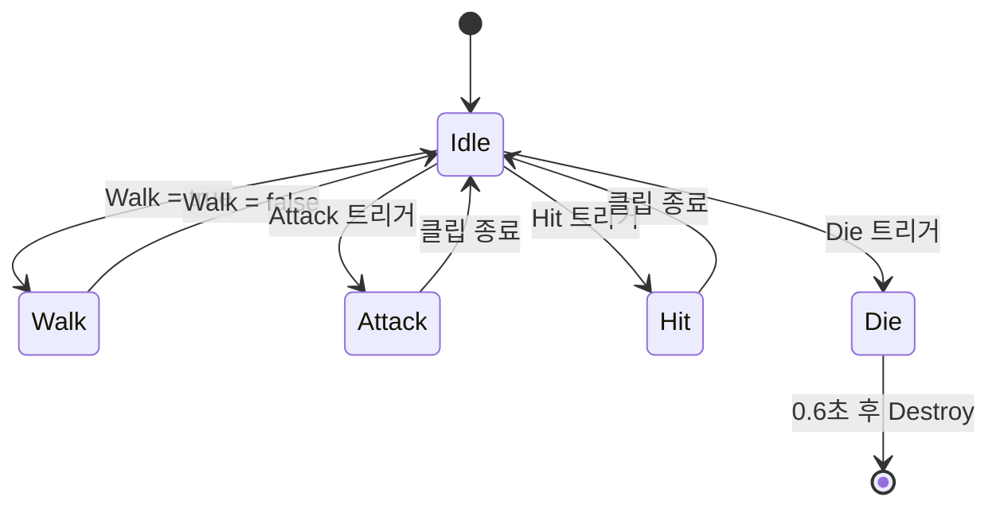

### 7.3 스프라이트 방향 전환

```csharp
// 타겟이 왼쪽에 있으면 flipX = true (좌우 반전)
protected void UpdateSpriteDirection(Vector2Int targetPos)
{
    if (targetPos.x < GridPosition.x)
        SpriteRenderer.flipX = true;
    else if (targetPos.x > GridPosition.x)
        SpriteRenderer.flipX = false;
}
```

> 이동·공격·텔레그래프 표시 시 자동으로 방향 업데이트

### 7.4 고속 이동 몬스터의 애니메이션

```
일반 이동: EnemyBase.OnTurnUpdate()에서 Walk=true → ResetWalkAfterDelay 코루틴
고속 이동: HasCustomMovementVisual() = true → SmoothMoveVisual() 내부에서 직접 제어
```

---

## 8. 이벤트 기반 통신

적 시스템은 **직접 참조 대신 GameEvents 정적 이벤트**로 다른 시스템과 소통합니다.

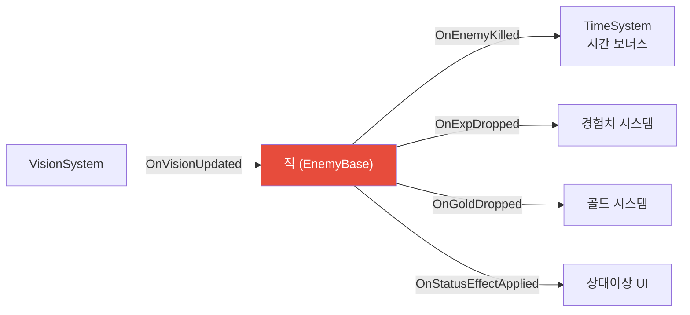

### 발행하는 이벤트

| 이벤트 | 시점 | 전달 데이터 |
|--------|------|-----------|
| `OnEnemyKilled` | 사망 | gridPosition, timeBonus |
| `OnExpDropped` | 사망 | gridPosition, expReward |
| `OnGoldDropped` | 사망 (goldMax > 0) | gridPosition, goldAmount |
| `OnStatusEffectApplied` | 공격 명중 (onHitEffect 존재) | StatusRequest |

### 구독하는 이벤트

| 이벤트 | 반응 |
|--------|------|
| `OnVisionUpdated` | 시야 범위에 따라 SpriteRenderer.enabled 토글 |

---

## 9. 확장성 — 새 몬스터 추가 방법

### 새 적 1종 추가에 필요한 작업

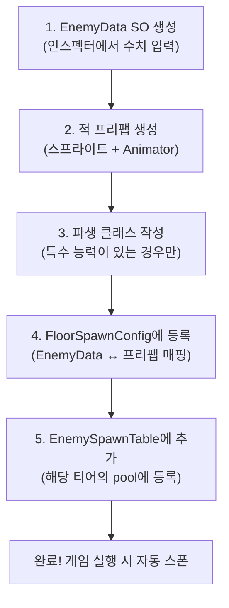

### 코드가 필요한 경우 vs 불필요한 경우

| 상황 | 필요한 작업 |
|------|-----------|
| 기본 추적 + 근접 공격 (뱀, 트롤) | **코드 불필요** — `EnemyBase` 기본 동작 사용 |
| 명중 시 상태이상 (역병쥐) | **코드 불필요** — `EnemyData.onHitEffect`에 SO 연결 |
| 특수 이동/공격 패턴 | 파생 클래스 1개 작성 → 필요한 메서드만 override |

### 파생 클래스 최소 구현 예시

```csharp
// 기본 동작만 사용하는 적 → 코드 거의 없음
public class EnemyNewMonster : EnemyBase
{
    // EnemyData SO에서 모든 수치 참조
    // 특수 능력이 없으면 override 불필요
}
```

---

## 파일 구조 요약

```
Assets/KKH/02. Scripts/
├── EnemyBase.cs              ← 모든 적의 공통 베이스 (476줄)
├── Enemies/                  ← 개별 적 AI (파생 클래스)
│   ├── EnemySnake.cs         ← 뱀 (기본)
│   ├── EnemyTroll.cs         ← 트롤 (기본)
│   ├── EnemyPlagueRat.cs     ← 역병쥐 (상태이상)
│   ├── EnemySpider.cs        ← 거미 (독+슬로우)
│   ├── EnemySkeleton.cs      ← 스켈레톤 (방패)
│   ├── EnemyBat.cs           ← 박쥐 (고속 2칸)
│   ├── EnemyMageSkeleton.cs  ← 마법사 (원거리)
│   └── EnemyGoblinThief.cs   ← 고블린 도적 (훔침+도주)
└── EnemySystem/              ← 스폰 시스템
    ├── EnemySpawner.cs       ← 스폰 실행기
    ├── EnemySpawnTable.cs    ← 난이도 곡선 (SO)
    ├── EnemySpawnEntry.cs    ← 스폰 결과 구조체
    ├── FloorSpawnConfig.cs   ← 층별 설정 (SO)
    └── RoomSpawnRule.cs      ← 방 타입별 규칙

Assets/KDU/01.Scripts/Data/
    └── EnemyData.cs          ← 적 데이터 SO 정의
```

---

## 핵심 요약 (한 줄씩)

1. **EnemyData SO** → 적의 모든 수치를 인스펙터에서 관리
2. **EnemySpawner** → 층/방 타입에 따라 자동으로 적 배치
3. **EnemyBase 템플릿 메서드** → 공격 발동 → 이동 → 공격 예고 (3단계)
4. **텔레그래프** → 공격 전 1턴 예고 → 플레이어 회피 기회 보장
5. **액션 포인트** → `moveSpeed` 값으로 적의 체감 속도 자연스럽게 차별화
6. **GameEvents** → 적과 다른 시스템 간 느슨한 연결
7. **확장성** → 기본 동작 적은 코드 0줄, 특수 적은 override만
