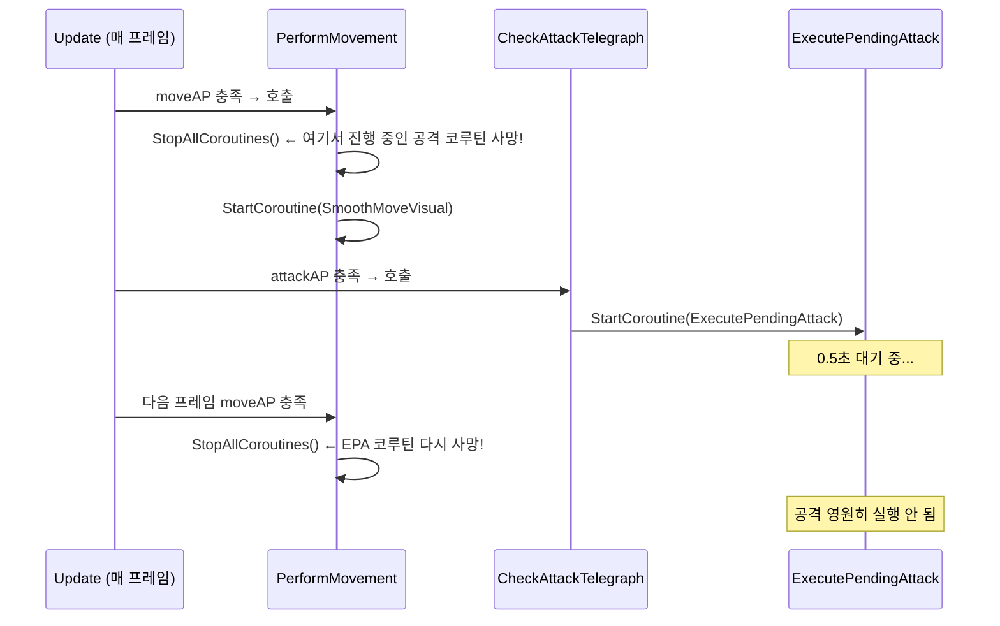

# 적 시스템 리팩토링 작업 계획서

> **프로젝트**: 60초 던전 (OHP_Project) | **작성일**: 2026-06-05

---

## Task 1 — 고블린 도적: 공격 자체가 안 되는 버그 수정

### 근본 원인 분석

코드 추적 결과 **버그 2개**가 공격을 완전히 차단하고 있습니다.

#### 버그 ①: `StopAllCoroutines()`가 공격 코루틴을 죽임



[PerformMovement 139번 줄](file:///D:/KKH/OHP_Project/Assets/KKH/02.%20Scripts/Enemies/EnemyGoblinThief.cs#L139)의 `StopAllCoroutines()`가 이동 코루틴뿐 아니라 **공격 코루틴까지 전부 죽입니다**.

#### 버그 ②: `_isAttacking` 플래그 미설정

[고블린의 ExecutePendingAttack](file:///D:/KKH/OHP_Project/Assets/KKH/02.%20Scripts/Enemies/EnemyGoblinThief.cs#L36-L60)은 `_isAttacking = true/false`를 설정하지 않음. 그 결과:

- `CheckAttackTelegraph()`의 `if (_isAttacking) return;` 가드가 작동 안 함
- 매 프레임 공격 코루틴이 중복 시작 → `StopAllCoroutines`에 의해 전부 사망

### 수정 절차

#### Step 1: 공격 코루틴을 별도 변수로 관리

`StopAllCoroutines()` 대신 **이동 코루틴만 선택적으로 중지**하도록 변경합니다.

[EnemyGoblinThief.cs](file:///D:/KKH/OHP_Project/Assets/KKH/02.%20Scripts/Enemies/EnemyGoblinThief.cs) 수정:

```diff
 public class EnemyGoblinThief : EnemyBase
 {
     private bool _hasStolenItem = false;
     private ItemInstance _stolenItem = null;
     private readonly List<Vector2Int> _movePath = new List<Vector2Int>();
+    private Coroutine _moveCoroutine;
```

#### Step 2: `PerformMovement()`에서 이동 코루틴만 정리

```diff
     protected override void PerformMovement()
     {
         _movePath.Clear();
         _movePath.Add(GridPosition);

         if (SquaredDistanceToPlayer() <= data.visionRange * data.visionRange)
         {
             for (int i = 0; i < 2; i++)
             {
                 if (TryStepLogical())
                     _movePath.Add(GridPosition);
             }
         }

-        StopAllCoroutines();
-        StartCoroutine(SmoothMoveVisual(0.08f));
+        if (_moveCoroutine != null)
+            StopCoroutine(_moveCoroutine);
+        _moveCoroutine = StartCoroutine(SmoothMoveVisual(0.08f));
     }
```

#### Step 3: `ExecutePendingAttack()`에 `_isAttacking` 플래그 추가

```diff
     protected override IEnumerator ExecutePendingAttack(Vector2Int targetCell, float delaySeconds)
     {
+        _isAttacking = true;
         ShowTelegraph(targetCell);

         yield return new WaitForSeconds(delaySeconds);

         if (!IsDead)
         {
             UpdateSpriteDirection(targetCell);
             if (_animator != null)
                 _animator.SetTrigger("Attack");
             if (Player.GridPosition == targetCell)
             {
                 int damage = RollAttackDamage();
                 if (TryHitPlayer(damage) && !_hasStolenItem)
                     TryStealItem();
             }
         }
         ClearTelegraphs();
+        _isAttacking = false;
     }
```

#### Step 4: `TryStealItem()`에 디버그 로그 보강

```diff
     private void TryStealItem()
     {
         var invController = FindFirstObjectByType<InventoryController>();
-        if (invController == null || invController.Items.Count == 0) return;
+        if (invController == null)
+        {
+            Debug.LogWarning($"[GoblinThief] InventoryController를 찾을 수 없음!");
+            return;
+        }
+        if (invController.Items.Count == 0)
+        {
+            Debug.Log($"[GoblinThief] 인벤토리 비어있어 탈취 불가.");
+            return;
+        }
```

#### Step 5: 테스트

1. 씬에 고블린 1마리 + 인벤토리에 아이템 2~3개 세팅
2. 고블린이 플레이어에게 **접근 → 텔레그래프 표시 → 공격 발동** 확인
3. 명중 시 **아이템 탈취 로그** 출력 확인
4. 탈취 후 **도주 AI 전환** 확인
5. 고블린 처치 후 **아이템 복구** 확인

### 수정 대상 파일

| 파일                                                                                                   | 수정 내용                                                                                                  |
| ------------------------------------------------------------------------------------------------------ | ---------------------------------------------------------------------------------------------------------- |
| [EnemyGoblinThief.cs](file:///D:/KKH/OHP_Project/Assets/KKH/02.%20Scripts/Enemies/EnemyGoblinThief.cs) | `_moveCoroutine` 추가, `StopAllCoroutines` → `StopCoroutine` 변경, `_isAttacking` 플래그 추가, 디버그 로그 |

---

## Task 2 — 원거리 적 공격 예고를 Tilemap 타일로 교체

### 현재 → 변경 후 비교

| 항목         | 현재 (프리팹 방식)                              | 변경 후 (Tilemap 방식)                      |
| ------------ | ----------------------------------------------- | ------------------------------------------- |
| 표시         | `Instantiate(telegraphPrefab)` → SpriteRenderer | `warningTilemap.SetTile(cell, warningTile)` |
| 제거         | `Destroy(indicator.gameObject)`                 | `warningTilemap.SetTile(cell, null)`        |
| 시야 연동    | `TelegraphIndicator.RefreshVisibility()`        | 항상 표시 (보스와 동일)                     |
| Tilemap 공유 | 없음                                            | 보스의 `warningTilemap`과 공유              |

### 수정 절차

#### Step 1: `EnemyBase.cs`에 Tilemap 참조 필드 추가

[EnemyBase.cs:26-27](file:///D:/KKH/OHP_Project/Assets/KKH/02.%20Scripts/EnemyBase.cs#L26-L27) 부근 수정:

```diff
-    [Tooltip("공격 예고(텔레그래프)를 격자 위에 띄울 프리팹. 없으면 시각 예고 안 뜸.")]
-    [SerializeField] protected TelegraphIndicator telegraphPrefab;
+    [Header("공격 예고 (Tilemap 방식)")]
+    [Tooltip("공격 예고 타일을 칠할 전용 Tilemap. 보스의 warningTilemap과 공유 가능.")]
+    [SerializeField] protected Tilemap warningTilemap;
+    [Tooltip("예고 칸에 칠할 타일 에셋.")]
+    [SerializeField] protected TileBase warningTile;
```

파일 상단에 `using UnityEngine.Tilemaps;` 추가.

#### Step 2: 내부 자료구조 변경

[EnemyBase.cs:77](file:///D:/KKH/OHP_Project/Assets/KKH/02.%20Scripts/EnemyBase.cs#L77) 부근 수정:

```diff
-    private readonly List<TelegraphIndicator> _activeTelegraphs = new();
+    private readonly List<Vector2Int> _activeTelegraphCells = new();
```

#### Step 3: `ShowTelegraph()` 메서드 변경

[EnemyBase.cs:257-263](file:///D:/KKH/OHP_Project/Assets/KKH/02.%20Scripts/EnemyBase.cs#L257-L263) 수정:

```diff
     protected void ShowTelegraph(Vector2Int cell)
     {
-        if (telegraphPrefab == null) return;
-        var ind = Instantiate(telegraphPrefab);
-        ind.Show(cell);
-        _activeTelegraphs.Add(ind);
+        if (warningTilemap == null || warningTile == null) return;
+        warningTilemap.SetTile(new Vector3Int(cell.x, cell.y, 0), warningTile);
+        _activeTelegraphCells.Add(cell);
     }
```

#### Step 4: `ClearTelegraphs()` 메서드 변경

[EnemyBase.cs:269-276](file:///D:/KKH/OHP_Project/Assets/KKH/02.%20Scripts/EnemyBase.cs#L269-L276) 수정:

```diff
     protected void ClearTelegraphs()
     {
-        foreach (var t in _activeTelegraphs)
+        if (warningTilemap != null)
         {
-            if (t != null) Destroy(t.gameObject);
+            foreach (var cell in _activeTelegraphCells)
+                warningTilemap.SetTile(new Vector3Int(cell.x, cell.y, 0), null);
         }
-        _activeTelegraphs.Clear();
+        _activeTelegraphCells.Clear();
     }
```

#### Step 5: `UpdateVisibility()`에서 텔레그래프 시야 동기화 제거

[EnemyBase.cs:165-176](file:///D:/KKH/OHP_Project/Assets/KKH/02.%20Scripts/EnemyBase.cs#L165-L176) 수정:

```diff
     protected void UpdateVisibility()
     {
         bool visible = VisionSystem.Instance != null && VisionSystem.Instance.IsVisible(GridPosition);
         SpriteRenderer.enabled = visible;
-
-        // 시야에서 사라지면 공격 예고 타일도 같이 숨김
-        foreach (var t in _activeTelegraphs)
-        {
-            if (t != null) t.RefreshVisibility();
-        }
+        // Tilemap 방식: 워닝 타일은 항상 표시 (보스와 동일 정책)
     }
```

#### Step 6: `TelegraphIndicator.cs` 삭제

[TelegraphIndicator.cs](file:///D:/KKH/OHP_Project/Assets/KDU/01.Scripts/Shared/TelegraphIndicator.cs)와 `.meta` 파일 삭제.

#### Step 7: 인스펙터 — 모든 적 프리팹 업데이트

1. Unity 에디터에서 각 적 프리팹을 열기
2. 기존 `telegraphPrefab` 슬롯 → 필드 자체가 사라져 있을 것 (삭제했으므로)
3. 새로운 `warningTilemap` 슬롯 → 씬의 Warning Tilemap 오브젝트 드래그
4. `warningTile` 슬롯 → 사용할 경고 타일 에셋 드래그

> [!IMPORTANT]
> 보스(`BossBase`)가 사용하는 `warningTilemap`과 **같은 Tilemap**을 공유합니다. 보스방에는 일반 적이 없고, 일반 층에는 보스가 없으므로 충돌 없음.

#### Step 8: 테스트

1. 일반 적(박쥐, 거미 등)이 플레이어 인접 시 **타일맵에 경고 타일** 표시되는지 확인
2. 공격 후 **경고 타일이 정상 제거**되는지 확인
3. 마법사 스켈레톤의 **직선 경로 전체에 타일** 표시되는지 확인
4. 적 사망 시 `ClearTelegraphs()`로 **잔여 타일 없이 정리**되는지 확인

### 수정 대상 파일

| 파일                                                                                                   | 수정 내용                                                      |
| ------------------------------------------------------------------------------------------------------ | -------------------------------------------------------------- |
| [EnemyBase.cs](file:///D:/KKH/OHP_Project/Assets/KKH/02.%20Scripts/EnemyBase.cs)                       | 필드 교체, ShowTelegraph/ClearTelegraphs/UpdateVisibility 변경 |
| [TelegraphIndicator.cs](file:///D:/KKH/OHP_Project/Assets/KDU/01.Scripts/Shared/TelegraphIndicator.cs) | **삭제**                                                       |
| 적 프리팹들 (인스펙터)                                                                                 | `warningTilemap` + `warningTile` 슬롯 할당                     |

---

## Task 3 — Area 전환 시 스폰 테이블 자동 갱신 (방안 A — 자체 작업)

> [!NOTE]
> 이 Task는 코드 수정 없이 **SO 에셋 + 인스펙터 작업**만으로 완료됩니다. 절차만 정리합니다.

### 핵심 원리

이미 [EnemySpawner.GetConfigForDepth(depth)](file:///D:/KKH/OHP_Project/Assets/KKH/02.%20Scripts/EnemySystem/EnemySpawner.cs#L287-L297)가 `floorConfigs` 리스트를 순회하며 depth 범위 매칭을 수행합니다. Area별로 `FloorSpawnConfig` SO를 만들어 등록하면 **depth가 바뀔 때 자동으로 다른 스폰 테이블 적용**.

### 작업 절차

#### Step 1: EnemySpawnTable SO 생성 (Area별 1개씩)

Project 창 우클릭 → `Create > 60s Dungeon > Enemy Spawn Table`

| SO 파일명          | 설명                                                 |
| ------------------ | ---------------------------------------------------- |
| `Area1_SpawnTable` | 하수구 적 (박쥐, 쥐, 거미, 뱀[Elite])                |
| `Area2_SpawnTable` | 던전 적 (마법사 스켈레톤, 고블린 도적, 페스트 쥐 등) |
| `Area3_SpawnTable` | 지옥 적                                              |

각 SO의 `tiers[]` 배열에 거리별 난이도 곡선 설정:

- `tiers[0]` = 거리 1 (Safe Room 바로 옆) → 약한 적 위주, 1~2마리
- `tiers[1]` = 거리 2 → 혼합, 2~3마리
- `tiers[2]` = 거리 3 → 강한 적 위주, 3~4마리
- ... (필요한 만큼)

#### Step 2: FloorSpawnConfig SO 생성 (Area별 1개씩)

Project 창 우클릭 → `Create > 60s Dungeon > Floor Spawn Config`

| SO 파일명             | minDepth | maxDepth |    spawnTable    | prefabMappings                                          |
| --------------------- | :------: | :------: | :--------------: | :------------------------------------------------------ |
| `Area1_SewerConfig`   |    1     |    4     | Area1_SpawnTable | (박쥐Data→박쥐Prefab, 쥐Data→쥐Prefab, ...)             |
| `Area2_DungeonConfig` |    6     |    9     | Area2_SpawnTable | (마법사Data→마법사Prefab, 고블린Data→고블린Prefab, ...) |
| `Area3_HellConfig`    |    11    |    14    | Area3_SpawnTable | (지옥 적 매핑들)                                        |

> [!WARNING]
> 보스 층(5/10/15)은 `EnemySpawner`가 `IsBossDepth` 체크로 스폰을 스킵하므로 Config 범위에서 **제외**해야 합니다.

#### Step 3: EnemySpawner 인스펙터에 등록

1. Hierarchy에서 `EnemySpawner` 컴포넌트를 가진 오브젝트 선택
2. `floorConfigs` 리스트에 위 3개 SO 추가:
   - Element 0 → `Area1_SewerConfig`
   - Element 1 → `Area2_DungeonConfig`
   - Element 2 → `Area3_HellConfig`

#### Step 4: 동작 확인

```
depth 1~4  → GetConfigForDepth → Area1_SewerConfig 선택 ✓
depth 5    → IsBossDepth → 스폰 스킵 ✓
depth 6~9  → GetConfigForDepth → Area2_DungeonConfig 선택 ✓
depth 10   → IsBossDepth → 스폰 스킵 ✓
depth 11~14 → GetConfigForDepth → Area3_HellConfig 선택 ✓
depth 15   → IsBossDepth → 스폰 스킵 ✓
```

#### Step 5 (선택): Area 전환 이벤트 추가

UI/사운드가 Area 전환을 감지해야 한다면:

[GameEvents.cs](file:///D:/KKH/OHP_Project/Assets/KDU/01.Scripts/Events/GameEvents.cs)에 추가:

```csharp
public static Action<int> OnAreaChanged; // areaIndex (1, 2, 3)
```

[FloorTransitionController.cs](file:///D:/KKH/OHP_Project/Assets/KDU/01.Scripts/Shared/FloorTransitionController.cs)의 `BuildFloorCoroutine()` 끝부분에:

```csharp
int newArea = MapGenerator.AreaFromDepth(runState.CurrentDepth);
int prevArea = runState.CurrentDepth > 1 ? MapGenerator.AreaFromDepth(runState.CurrentDepth - 1) : 0;
if (newArea != prevArea)
    GameEvents.OnAreaChanged?.Invoke(newArea);
```

---

## 작업 순서 요약

| 순서 | Task                          | 예상 소요 |                    비고                    |
| :--: | ----------------------------- | :-------: | :----------------------------------------: |
|  1   | Task 1: 고블린 공격 버그 수정 |   30분    |              코드 3군데 수정               |
|  2   | Task 3: 스폰 테이블 구성      |  1~2시간  |         인스펙터 작업 (자체 작업)          |
|  3   | Task 2: 텔레그래프 타일 전환  |  2~3시간  | EnemyBase 핵심 변경 + 프리팹 전부 업데이트 |
