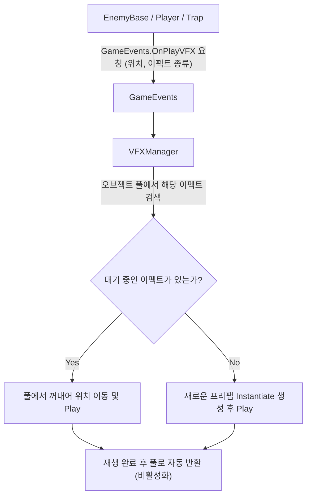

# 통합 이펙트 매니저(VFX Manager) 시스템 구축 가이드

이 가이드는 게임 내 피격, 사망, 스킬 사용 등 모든 특수효과(VFX)를 개별 오브젝트가 처리하지 않고, **중앙 집중형 이펙트 매니저와 오브젝트 풀링(Object Pooling)을 사용하여 일괄 제어 및 최적화**하는 시스템의 설계 및 작업 절차를 다룹니다.

---

## 1. 시스템 아키텍처 흐름

이벤트 기반(Event-Driven) 및 오브젝트 풀링(Object Pooling) 구조를 사용합니다.



---

## 2. 연동 스크립트 작성 절차

### 1단계: 이펙트 종류 정의 (`VFXType.cs`)

먼저, 게임에서 사용할 모든 VFX 종류를 enum으로 정의하여 구분하기 편하게 만듭니다.

```csharp
public enum VFXType
{
    None = 0,

    // 전투 관련 (Combat)
    PlayerHit,           // 플레이어 피격 (붉은 피 등)
    PlayerDeath,         // 플레이어 사망 연출
    PlayerMeleeSlash,    // 플레이어 근접 공격 슬래시 궤적
    PlayerRangedDagger,  // 플레이어 단검 투척 투사체 궤적 및 충돌 파편
    MonsterHit,          // 몬스터 피격 (초록 피 등)
    MonsterDeath,        // 몬스터 사망 (뼛조각, 먼지, 파편 등)
    MonsterTelegraph,    // 몬스터 공격 예고 범위 바닥 장판
    BossSkillA,          // 보스 전용 광역 공격 기술 이펙트

    // 던전 환경 및 함정 (Environment & Traps)
    TrapSpike,           // 가시 함정 솟구침 및 먼지 파편
    TrapGas,             // 가스 함정 독가스 살포
    TrapAlarm,           // 경보 함정 발동 시각 파동
    TrapTriggered,       // 함정 발동 공용 이펙트
    FloorExit,           // 출구 포탈 및 다음 층 이동 포탈
    SafeRoomEnter,       // 세이프룸 진입 시 시간 정지 시각 효과

    // 아이템 및 상태이상 (Items & Status)
    ItemHeal,            // 체력 포션 사용 및 치유
    ItemCollectGold,     // 골드 획득 연출
    ScrollScan,          // 지도 스크롤 사용 시 안개 걷힘 맵 스캔 광파
    ScrollPurify,        // 저주 정화 스크롤 사용 시 신성한 정화 빛줄기
    StatusBurn,          // 화상 상태 디버프 지속 화염 효과
    StatusPoison,        // 중독 상태 디버프 지속 가스 효과
    StatusFreeze         // 빙결 상태 디버프 지속 얼음 효과
}
```

### 2단계: 풀 관리형 이펙트 헬퍼 (`PoolableVFX.cs`)

기존에 오브젝트를 직접 파괴하던 `AutoDestroyParticle`을 대체합니다. 파티클 재생이 끝나면 파괴하지 않고 **VFXManager의 풀로 스스로 비활성화 및 반환** 처리합니다.

```csharp
using UnityEngine;

[RequireComponent(typeof(ParticleSystem))]
public class PoolableVFX : MonoBehaviour
{
    private ParticleSystem _particleSystem;
    private VFXManager _manager;
    private VFXType _myType;

    private void Awake()
    {
        _particleSystem = GetComponent<ParticleSystem>();
    }

    public void Init(VFXManager manager, VFXType type)
    {
        _manager = manager;
        _myType = type;
    }

    private void OnEnable()
    {
        if (_particleSystem != null)
        {
            _particleSystem.Play();
        }
    }

    private void Update()
    {
        // 파티클 시스템 재생이 완료되었는지 체크
        if (_particleSystem != null && !_particleSystem.isPlaying)
        {
            ReturnToPool();
        }
    }

    private void ReturnToPool()
    {
        gameObject.SetActive(false);
        if (_manager != null)
        {
            _manager.ReturnToPool(_myType, this);
        }
    }
}
```

### 3단계: 중앙 이펙트 매니저 (`VFXManager.cs`)

모든 이펙트의 풀을 생성, 반환, 검색 및 재생하며 `GameEvents`를 통해 전역에서 발동 명령을 받습니다.

```csharp
using System.Collections.Generic;
using UnityEngine;

public class VFXManager : MonoBehaviour
{
    public static VFXManager Instance { get; private set; }

    [System.Serializable]
    public struct VFXEntry
    {
        public VFXType type;
        public GameObject prefab;
        public int initialPoolSize;
    }

    [Header("이펙트 프리팹 매핑 설정")]
    [SerializeField] private List<VFXEntry> vfxList;

    // 이펙트 종류별 오브젝트 풀 대기 큐
    private Dictionary<VFXType, Queue<PoolableVFX>> _poolDictionary;
    private Dictionary<VFXType, GameObject> _prefabDictionary;

    private void Awake()
    {
        if (Instance == null)
        {
            Instance = this;
            DontDestroyOnLoad(gameObject);
        }
        else
        {
            Destroy(gameObject);
            return;
        }

        InitializePools();
    }

    private void OnEnable()
    {
        // GameEvents에 이벤트 구독 연동 예정 (예: GameEvents.OnPlayVFX += PlayVFX;)
    }

    private void OnDisable()
    {
        // GameEvents 이벤트 구독 해제
    }

    private void InitializePools()
    {
        _poolDictionary = new Dictionary<VFXType, Queue<PoolableVFX>>();
        _prefabDictionary = new Dictionary<VFXType, GameObject>();

        foreach (var entry in vfxList)
        {
            if (entry.type == VFXType.None || entry.prefab == null) continue;

            _prefabDictionary[entry.type] = entry.prefab;
            _poolDictionary[entry.type] = new Queue<PoolableVFX>();

            // 초기 풀 크기만큼 미리 프리팹 생성 및 비활성화하여 대기
            for (int i = 0; i < entry.initialPoolSize; i++)
            {
                CreateNewVFXInstance(entry.type, entry.prefab);
            }
        }
    }

    private PoolableVFX CreateNewVFXInstance(VFXType type, GameObject prefab)
    {
        GameObject obj = Instantiate(prefab, transform);
        obj.SetActive(false);

        PoolableVFX poolable = obj.GetComponent<PoolableVFX>();
        if (poolable == null)
        {
            poolable = obj.AddComponent<PoolableVFX>();
        }

        poolable.Init(this, type);
        _poolDictionary[type].Enqueue(poolable);
        return poolable;
    }

    /// <summary>
    /// 외부 이벤트 또는 직접 호출을 받아 특정 위치에 이펙트를 재생합니다.
    /// </summary>
    public void PlayVFX(Vector3 position, VFXType type)
    {
        if (!_poolDictionary.ContainsKey(type))
        {
            Debug.LogWarning($"VFXManager: {type}에 대한 풀이나 프리팹이 설정되지 않았습니다.");
            return;
        }

        PoolableVFX vfx = null;
        var queue = _poolDictionary[type];

        // 대기 중인 풀에 사용 가능한 인스턴스가 있는지 탐색
        if (queue.Count > 0)
        {
            vfx = queue.Dequeue();
        }
        else
        {
            // 풀이 비어있으면 런타임에 동적 추가 생성
            if (_prefabDictionary.TryGetValue(type, out GameObject prefab))
            {
                vfx = CreateNewVFXInstance(type, prefab);
                queue.Dequeue(); // Enqueue되었던 값을 꺼내옴
            }
        }

        if (vfx != null)
        {
            vfx.transform.position = position;
            vfx.gameObject.SetActive(true);
        }
    }

    /// <summary>
    /// PoolableVFX가 재생 종료 후 호출하여 풀 큐로 인스턴스를 반환합니다.
    /// </summary>
    public void ReturnToPool(VFXType type, PoolableVFX vfx)
    {
        if (_poolDictionary.ContainsKey(type))
        {
            _poolDictionary[type].Enqueue(vfx);
        }
    }
}
```

---

## 3. 작업 및 적용 절차 (4단계)

### [1단계] 이벤트 추가 (`GameEvents.cs`)

프로젝트의 정적 이벤트 허브 클래스인 `GameEvents`에 이펙트 호출을 받기 위한 static 이벤트를 하나 정의합니다.

```csharp
// GameEvents.cs에 추가할 라인
public static System.Action<UnityEngine.Vector3, VFXType> OnPlayVFX;
```

_그리고 `VFXManager.cs` 내의 `OnEnable / OnDisable`에서 이 이벤트를 구독하여 `PlayVFX`가 실행되도록 연결해 줍니다._

```csharp
// VFXManager.cs의 OnEnable/OnDisable 수정안
private void OnEnable()
{
    GameEvents.OnPlayVFX += PlayVFX;
}
private void OnDisable()
{
    GameEvents.OnPlayVFX -= PlayVFX;
}
```

### [2단계] 매니저 씬 배치 및 설정

1. 씬에 빈 오브젝트를 생성하고 이름을 `VFX_Manager`로 변경합니다.
2. `VFXManager` 컴포넌트를 붙여줍니다.
3. 인스펙터의 **Vfx List** 목록에 이펙트들을 매핑합니다:
   - **Type**: `MonsterHit` -> **Prefab**: 초록 피격 파티클 프리팹 지정, **Initial Pool Size**: `10`
   - **Type**: `MonsterDeath` -> **Prefab**: 사망 뼛조각 파티클 프리팹 지정, **Initial Pool Size**: `5`

### [3단계] 호출 코드 변경 (예: `EnemyBase.cs`)

기존에 `EnemyBase`에 붙어있던 복잡한 프리팹 변수들과 Instantiate 호출 로직을 정리하고 **단 한 줄의 이벤트 호출**로 교체합니다.

- **피격 시 연출 호출 변경**:

```csharp
// 기존
if (hitParticlePrefab != null) Instantiate(hitParticlePrefab, transform.position, Quaternion.identity);

// 변경 후 (통합 매니저 호출)
GameEvents.OnPlayVFX?.Invoke(transform.position, VFXType.MonsterHit);
```

- **사망 시 연출 호출 변경**:

```csharp
// 기존
if (deathEffectPrefab != null) Instantiate(deathEffectPrefab, transform.position, Quaternion.identity);

// 변경 후 (통합 매니저 호출)
GameEvents.OnPlayVFX?.Invoke(transform.position, VFXType.MonsterDeath);
```

---

## 4. 아키텍처 전환 시 주의사항

- **파티클 재생 시간 설정**: 각 이펙트 파티클 프리팹의 **`Duration`**과 **`Start Lifetime`**이 정확히 정해져 있어야 하며, **`Looping`이 반드시 꺼져 있어야** 합니다. `Looping`이 켜져 있으면 재생이 끝나지 않아 풀로 반환되지 못합니다.
- **로컬/월드 스페이스**: 파티클 시스템의 **`Simulation Space`**는 기본적으로 `World`로 되어 있어야 연출이 실행되는 도중에 몬스터가 움직이거나 사라져도 이펙트 잔상이 올바른 위치에 자연스럽게 남습니다.
